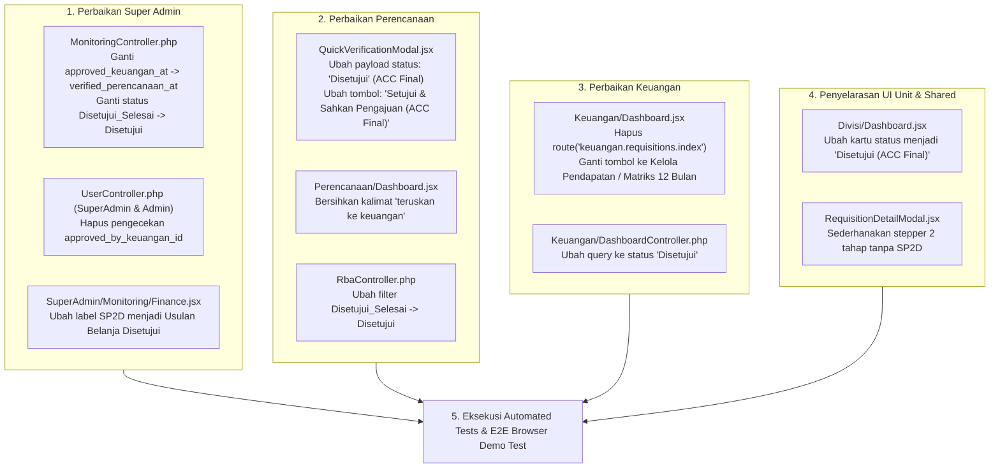

# [ISSUE / PLANNING] Audit Sistem Menyeluruh, Perbaikan Error Antar-Role (Super Admin, Perencanaan, Keuangan, Unit), dan Siklus Pengujian Demo Test End-to-End

**Tipe**: Bug Fix / Quality Assurance / End-to-End Testing & Hardening  
**Prioritas**: P0 - Sangat Tinggi (*System Stability & Production Readiness*)  
**Status**: Ready for Implementation  
**Label**: `bug-fix`, `quality-assurance`, `e2e-demo-test`, `super-admin`, `perencanaan`, `keuangan`, `divisi`, `blud-workflow`  
**Target Pelaksana**: Junior Programmer & AI Model  
*(Dokumen ini berisi panduan teknis mendalam dan investigasi akar masalah untuk menuntaskan error yang ditemukan saat operasional aplikasi pasca-perubahan alur belanja BLUD, dilanjutkan dengan prosedur demo test berulang hingga seluruh fitur berjalan 100% normal tanpa error).*

---

## 1. Ringkasan Temuan Masalah & Investigasi Akar Masalah (*Root Cause Analysis*)

Berdasarkan pengujian operasional terbaru, ditemukan 3 error utama serta beberapa temuan inkonsistensi query warisan:

### 1.1 Error Super Admin: Monitoring Kas & Relasi (*Column Not Found*)
* **Gejala**: Ketika Super Admin membuka menu **Monitoring Kas & Relasi** (`/super-admin/monitoring/finance`), muncul error database:
  ```text
  Column not found: 1054 Unknown column 'approved_keuangan_at' in 'order clause'
  (SQL: select * from `requisitions` where (`budget_year` = 2027 or `fiscal_year` = 2027) 
   and `status` = Disetujui_Selesai order by `approved_keuangan_at` desc limit 10)
  ```
* **Akar Masalah**:
  1. Pada [app/Http/Controllers/SuperAdmin/MonitoringController.php](file:///d:/Kampus/Nabil_2SIB/laragon-6.0-minimal/www/rsj-req-app/app/Http/Controllers/SuperAdmin/MonitoringController.php) baris 112–119, method `finance()` memanggil:
     `->where('status', 'Disetujui_Selesai')->latest('approved_keuangan_at')`
     Padahal kolom `approved_keuangan_at` telah dihapus (*drop*) dari tabel `requisitions` pada migrasi pembersihan alur, dan status belanja yang disahkan kini adalah `'Disetujui'`.
  2. Pada [app/Http/Controllers/SuperAdmin/UserController.php](file:///d:/Kampus/Nabil_2SIB/laragon-6.0-minimal/www/rsj-req-app/app/Http/Controllers/SuperAdmin/UserController.php) baris 212 dan [app/Http/Controllers/Admin/UserController.php](file:///d:/Kampus/Nabil_2SIB/laragon-6.0-minimal/www/rsj-req-app/app/Http/Controllers/Admin/UserController.php) baris 298, validasi penghapusan pengguna masih memeriksa kolom yang telah didrop:
     `->orWhere('approved_by_keuangan_id', $user->id)`. Ini akan memicu error SQL serupa saat user Keuangan dihapus.
  3. Pada tampilan [resources/js/Pages/SuperAdmin/Monitoring/Finance.jsx](file:///d:/Kampus/Nabil_2SIB/laragon-6.0-minimal/www/rsj-req-app/resources/js/Pages/SuperAdmin/Monitoring/Finance.jsx), antarmuka masih memuat teks warisan *"10 Pencairan SP2D Terkini"*, *"Lunas SP2D"*, dan referensi berkas SP2D.

### 1.2 Error Perencanaan: Telaah Cepat Gagal Validasi & Tombol Masih "Teruskan ke Keuangan"
* **Gejala**: Saat staf Perencanaan melakukan verifikasi melalui tombol telaah cepat di halaman daftar usulan, muncul error validasi:
  ```text
  Status verifikasi harus berupa Disetujui atau Ditolak.
  ```
  Serta teks tombol pada modal masih bertuliskan **"Setujui & Teruskan ke Keuangan"**.
* **Akar Masalah**:
  1. Komponen modal cepat [resources/js/Pages/Perencanaan/Requisitions/Partials/QuickVerificationModal.jsx](file:///d:/Kampus/Nabil_2SIB/laragon-6.0-minimal/www/rsj-req-app/resources/js/Pages/Perencanaan/Requisitions/Partials/QuickVerificationModal.jsx) pada baris 127 masih mengirimkan payload data lama:
     ```javascript
     router.put(route('perencanaan.requisitions.update', requisition.id), {
         status: 'Diproses_Keuangan', // <-- SALAH: Masih mengirim status lama
         notes_perencanaan: notesPerencanaan,
         items: itemsState,
     });
     ```
     Sementara controller backend [app/Http/Controllers/Perencanaan/RequisitionController.php](file:///d:/Kampus/Nabil_2SIB/laragon-6.0-minimal/www/rsj-req-app/app/Http/Controllers/Perencanaan/RequisitionController.php) sekarang hanya memvalidasi status `Disetujui` (ACC Final) atau `Ditolak`. Akibatnya, request ditolak oleh Laravel Validator.
  2. Label tombol baris 535 dan toast pesan sukses baris 139 masih merujuk ke *"Teruskan ke Keuangan"*.
  3. Narasi petunjuk telaah pada [resources/js/Pages/Perencanaan/Dashboard.jsx](file:///d:/Kampus/Nabil_2SIB/laragon-6.0-minimal/www/rsj-req-app/resources/js/Pages/Perencanaan/Dashboard.jsx) (baris 349 & 493) masih menuliskan kalimat *"sebelum diteruskan ke Keuangan"*.

### 1.3 Error Keuangan: Layar Blank Putih Saat Login
* **Gejala**: Saat pengguna dengan role `keuangan` berhasil login, browser langsung mengalami *crash* dan hanya menampilkan **layar putih polos (*blank screen*)**.
* **Akar Masalah**:
  1. Saat role `keuangan` login, rute diarahkan ke `/keuangan/dashboard` yang merender [resources/js/Pages/Keuangan/Dashboard.jsx](file:///d:/Kampus/Nabil_2SIB/laragon-6.0-minimal/www/rsj-req-app/resources/js/Pages/Keuangan/Dashboard.jsx).
  2. Pada baris 106 [Keuangan/Dashboard.jsx](file:///d:/Kampus/Nabil_2SIB/laragon-6.0-minimal/www/rsj-req-app/resources/js/Pages/Keuangan/Dashboard.jsx), terdapat kode komponen Link:
     ```jsx
     <Link href={route('keuangan.requisitions.index')}>
         Validasi Pengajuan Anggaran
     </Link>
     ```
  3. Rute `keuangan.requisitions.index` telah **dihapus secara permanen** dari [routes/web.php](file:///d:/Kampus/Nabil_2SIB/laragon-6.0-minimal/www/rsj-req-app/routes/web.php) karena alur belanja unit tidak lagi masuk ke Keuangan.
  4. Ketika helper Ziggy JavaScript `route('keuangan.requisitions.index')` dieksekusi di sisi client tanpa ada rute terdaftar, Ziggy melempar *unhandled exception*:
     `Ziggy error: route 'keuangan.requisitions.index' is not in the route list.`
     Dalam React, exception tanpa Error Boundary menyebabkan seluruh pohon komponen *unmount*, menghasilkan **layar putih total**.
  5. Di sisi backend controller [app/Http/Controllers/Keuangan/DashboardController.php](file:///d:/Kampus/Nabil_2SIB/laragon-6.0-minimal/www/rsj-req-app/app/Http/Controllers/Keuangan/DashboardController.php) baris 47 dan 109, query `$totalSpent` dan `$totalProcessed` masih memfilter status lama `Disetujui_Selesai`.

### 1.4 Temuan Tambahan: Filter Realisasi RBA & Stepper Audit Trail
1. Di [app/Http/Controllers/Perencanaan/RbaController.php](file:///d:/Kampus/Nabil_2SIB/laragon-6.0-minimal/www/rsj-req-app/app/Http/Controllers/Perencanaan/RbaController.php) (baris 246, 1054, 1055, 1112), perhitungan realisasi belanja unit pada lembar RBA masih menyaring status `'Disetujui_Selesai'`. Akibatnya, usulan yang baru berstatus `'Disetujui'` tidak terhitung dalam rekap realisasi belanja RBA.
2. Di [resources/js/Pages/Divisi/Dashboard.jsx](file:///d:/Kampus/Nabil_2SIB/laragon-6.0-minimal/www/rsj-req-app/resources/js/Pages/Divisi/Dashboard.jsx), kartu status ke-3 masih berlabel *"Proses Keuangan"*.
3. Di [resources/js/Pages/Shared/RequisitionDetailModal.jsx](file:///d:/Kampus/Nabil_2SIB/laragon-6.0-minimal/www/rsj-req-app/resources/js/Pages/Shared/RequisitionDetailModal.jsx), teks deskripsi stepper status masih memuat *"penerbitan SP2D oleh Bagian Keuangan"*.

---

## 2. Solusi Perbaikan Teknis (*Technical Fix Specification*)



---

## 3. Tahap-Tahap Implementasi Rinci (Untuk Junior Programmer & AI)

### Tahap 1: Perbaikan Backend Controller

#### 1.1 Perbaiki [app/Http/Controllers/SuperAdmin/MonitoringController.php](file:///d:/Kampus/Nabil_2SIB/laragon-6.0-minimal/www/rsj-req-app/app/Http/Controllers/SuperAdmin/MonitoringController.php)
* **Target Masalah**: Method `finance()` (baris 112–119).
* **Ubah Kode**:
  ```php
  // SEBELUM (ERROR):
  $disbursedReqs = Requisition::where(function ($q) use ($activeYear) {
      $q->where('budget_year', $activeYear)->orWhere('fiscal_year', $activeYear);
  })
      ->where('status', 'Disetujui_Selesai')
      ->with(['division:id,name', 'unit:id,name'])
      ->latest('approved_keuangan_at')
      ->limit(10)
      ->get();

  // SESUDAH (BENAR):
  $disbursedReqs = Requisition::where(function ($q) use ($activeYear) {
      $q->where('budget_year', $activeYear)->orWhere('fiscal_year', $activeYear);
  })
      ->where('status', 'Disetujui')
      ->with(['division:id,name', 'unit:id,name'])
      ->latest('verified_perencanaan_at')
      ->limit(10)
      ->get();
  ```

#### 1.2 Perbaiki [app/Http/Controllers/SuperAdmin/UserController.php](file:///d:/Kampus/Nabil_2SIB/laragon-6.0-minimal/www/rsj-req-app/app/Http/Controllers/SuperAdmin/UserController.php) & [app/Http/Controllers/Admin/UserController.php](file:///d:/Kampus/Nabil_2SIB/laragon-6.0-minimal/www/rsj-req-app/app/Http/Controllers/Admin/UserController.php)
* **Target Masalah**: Method `destroy()` pengecekan riwayat verifikasi usulan.
* **Ubah Kode**: Hapus `->orWhere('approved_by_keuangan_id', $user->id)` pada kedua controller tersebut karena kolom tersebut sudah tidak ada lagi di tabel `requisitions`.

#### 1.3 Perbaiki [app/Http/Controllers/Keuangan/DashboardController.php](file:///d:/Kampus/Nabil_2SIB/laragon-6.0-minimal/www/rsj-req-app/app/Http/Controllers/Keuangan/DashboardController.php)
* **Target Masalah**: Method `index()` (baris 46–54 dan 109–116).
* **Ubah Kode**:
  * Ganti `$q->where('status', 'Disetujui_Selesai')` menjadi `$q->where('status', 'Disetujui')`.
  * Ganti `$totalProcessed = Requisition::where('status', 'Disetujui_Selesai')` menjadi `$totalProcessed = Requisition::where('status', 'Disetujui')`.

#### 1.4 Perbaiki [app/Http/Controllers/Perencanaan/RbaController.php](file:///d:/Kampus/Nabil_2SIB/laragon-6.0-minimal/www/rsj-req-app/app/Http/Controllers/Perencanaan/RbaController.php)
* **Target Masalah**: Baris 246, 1054, 1055, dan 1112.
* **Ubah Kode**: Ganti seluruh filter status `'Disetujui_Selesai'` menjadi `'Disetujui'` agar usulan belanja yang disahkan Perencanaan langsung dihitung sebagai realisasi belanja RBA.

---

### Tahap 2: Perbaikan Antarmuka Pengguna (Frontend React / JSX)

#### 2.1 Perbaiki [resources/js/Pages/Keuangan/Dashboard.jsx](file:///d:/Kampus/Nabil_2SIB/laragon-6.0-minimal/www/rsj-req-app/resources/js/Pages/Keuangan/Dashboard.jsx) *(Mengatasi Blank Screen)*
* **Target Masalah**: Baris 105–114 dan 117–129.
* **Ubah Kode**:
  * Hapus `<Link href={route('keuangan.requisitions.index')}>` yang memicu error Ziggy.
  * Ganti tombol aksi utama menjadi 2 tombol pintasan relevan ke fitur Keuangan:
    1. **"Kelola Pendapatan BLUD"** $\rightarrow$ `href={route('revenues.index')}`
    2. **"Matriks Realisasi 12 Bulan"** $\rightarrow$ `href={route('reports.revenue-monthly-matrix')}`
  * Hapus banner notifikasi *"Antrean Validasi: Segera verifikasi pencairan dana Requisition"* karena Keuangan tidak lagi memproses validasi berkas belanja unit.

#### 2.2 Perbaiki [resources/js/Pages/Perencanaan/Requisitions/Partials/QuickVerificationModal.jsx](file:///d:/Kampus/Nabil_2SIB/laragon-6.0-minimal/www/rsj-req-app/resources/js/Pages/Perencanaan/Requisitions/Partials/QuickVerificationModal.jsx) *(Mengatasi Error Telaah)*
* **Target Masalah**: Baris 127, 139, dan 535.
* **Ubah Kode**:
  1. Pada fungsi `handleSubmitApprove`, ubah payload status:
     ```javascript
     status: 'Disetujui', // BUKAN 'Diproses_Keuangan'
     ```
  2. Ubah pesan toast sukses:
     ```javascript
     title: 'Usulan belanja berhasil disetujui & disahkan (ACC Final)',
     ```
  3. Ubah teks tombol aksi utama (baris 535):
     ```jsx
     <span>Setujui & Sahkan Pengajuan (ACC Final)</span>
     ```

#### 2.3 Perbaiki [resources/js/Pages/SuperAdmin/Monitoring/Finance.jsx](file:///d:/Kampus/Nabil_2SIB/laragon-6.0-minimal/www/rsj-req-app/resources/js/Pages/SuperAdmin/Monitoring/Finance.jsx)
* **Target Masalah**: Header dan tabel daftar belanja disetujui.
* **Ubah Kode**:
  * Ganti judul *"10 Pencairan SP2D Terkini"* menjadi *"10 Usulan Belanja Disetujui Terkini"*.
  * Ganti kolom tanggal *"Tgl SP2D"* menjadi *"Tgl Disetujui"* dan gunakan `item.verified_perencanaan_at`.
  * Hapus kolom *"Nomor SP2D"* dan badge *"Lunas SP2D"*, ganti dengan badge *"Disetujui Perencanaan (ACC Final)"*.

#### 2.4 Perbaiki Teks Narasi di Halaman Terkait
1. [resources/js/Pages/Perencanaan/Dashboard.jsx](file:///d:/Kampus/Nabil_2SIB/laragon-6.0-minimal/www/rsj-req-app/resources/js/Pages/Perencanaan/Dashboard.jsx): Hapus kata *"sebelum diteruskan ke Keuangan"*, sesuaikan menjadi *"sebelum disetujui dan memotong pagu RBA"*.
2. [resources/js/Pages/Divisi/Dashboard.jsx](file:///d:/Kampus/Nabil_2SIB/laragon-6.0-minimal/www/rsj-req-app/resources/js/Pages/Divisi/Dashboard.jsx): Ganti label kartu status *"Proses Keuangan"* menjadi *"Disetujui Perencanaan"*.
3. [resources/js/Pages/Shared/RequisitionDetailModal.jsx](file:///d:/Kampus/Nabil_2SIB/laragon-6.0-minimal/www/rsj-req-app/resources/js/Pages/Shared/RequisitionDetailModal.jsx): Bersihkan deskripsi stepper status yang menyebutkan verifikasi Keuangan atau penerbitan SP2D.

---

### Tahap 3: Kompilasi Aset Frontend
Setelah perubahan file JSX selesai, jalankan kompilasi aset:
```sh
npm run build
```
Pastikan hasil build berstatus `✓ built in ...` tanpa peringatan syntax error ataupun import broken.

---

### Tahap 4: Pengujian Demo Otomatis & Manual (*Role-by-Role Demo Testing Matrix*)

Lakukan pengujian secara komprehensif pada **5 Role** di sistem:

| No | Role | Rute / Fitur yang Diuji | Parameter Uji | Ekspektasi Hasil |
|---|---|---|---|---|
| 1 | **Super Admin** | `/super-admin/dashboard` | Akses ringkasan eksekutif | Halaman terbuka responsif, widget KPI tampil utuh. |
| 2 | **Super Admin** | `/super-admin/monitoring/finance` | Klik menu Monitoring Kas & Relasi | **Bebas Error 1054**. Menampilkan tabel pendapatan dan 10 belanja disetujui terkini. |
| 3 | **Super Admin** | `/super-admin/monitoring/rba` | Pantau pergeseran RBA | Bebas error, rekap pergeseran multi-tahun muncul akurat. |
| 4 | **Super Admin** | `/super-admin/monitoring/requisitions` | Pantau usulan seluruh unit | Filter status berfungsi (Pending, Disetujui, Ditolak). |
| 5 | **Super Admin** | `/super-admin/users` | Hapus / toggle user | Tidak memicu error `Column not found approved_by_keuangan_id`. |
| 6 | **Admin** | `/admin/dashboard` & `/admin/divisions` | Kelola master divisi & unit | CRUD berjalan normal, pagination lancar. |
| 7 | **Divisi / Unit** | `/divisi/dashboard` | Login sebagai unit | Kartu status menampilkan `Pending_Perencanaan` dan `Disetujui`. |
| 8 | **Divisi / Unit** | `/divisi/requisitions` (Buat Baru) | Input usulan barang katalog SSH & manual | Berhasil tersimpan dengan status `Pending_Perencanaan`. |
| 9 | **Perencanaan** | `/perencanaan/dashboard` | Buka dashboard perencanaan | Tidak ada kalimat *"teruskan ke keuangan"*, metrik akurat. |
| 10 | **Perencanaan** | `/perencanaan/requisitions` (Telaah Cepat Modal) | Klik tombol telaah di tabel, klik Setujui | **Bebas Error Validasi**. Tombol bertuliskan "Setujui & Sahkan", usulan berubah `Disetujui`, pagu RBA terpotong. |
| 11 | **Perencanaan** | `/perencanaan/requisitions/{id}` (Telaah Detail) | Masuk halaman detail telaah, klik Setujui | Berhasil ACC Final, pagu rekening RBA berkurang permanen. |
| 12 | **Keuangan** | `/keuangan/dashboard` | Login sebagai akun keuangan | **Bebas Layar Putih (Blank)**. Dashboard terbuka normal dengan grafik realisasi DPA & tren pendapatan. |
| 13 | **Keuangan** | `/keuangan/revenues` | Buka daftar pendapatan & klik "Atur Target" | Modal target fleksibel terbuka, simpan target Jan-Des berhasil. |
| 14 | **Keuangan** | `/keuangan/reports/revenue-monthly-matrix` | Buka Matriks 12 Bulan & Cetak | Tabel komparasi Jan-Des muncul rapi, ekspor CSV berfungsi, cetak landscape ber-kop resmi. |
| 15 | **Keuangan** | `/keuangan/reports/surplus-deficit` | Cek Laporan Surplus / Defisit | Belanja bersumber dari usulan `Disetujui`, formula surplus akurat. |

---

### Tahap 5: Pengujian Otomatis (*Automated Feature Tests*)
Jalankan seluruh test suite Laravel untuk memastikan nol regresi (*zero regression*):
```sh
php artisan test
```
Target: **202+ tests passed, 0 failures, 0 errors**.

Jika ditemukan kegagalan pada test tertentu:
1. Analisis pesan kegagalan dan file yang terkait.
2. Lakukan perbaikan pada kode implementasi atau data mock pengujian.
3. Jalankan kembali `php artisan test` hingga seluruhnya berwarna hijau.

---

### Tahap 6: Eksekusi Demo Uji Menggunakan Browser Subagent (*Visual E2E Verification*)
Gunakan subagent browser atau navigasi langsung pada live app (port 8000 / virtual host Laragon) untuk memverifikasi secara visual:
1. Buka browser dan login berturut-turut:
   - Super Admin: `superadmin@rsjtampan.riau.go.id`
   - Perencanaan: `perencanaan@rsjtampan.riau.go.id`
   - Keuangan: `keuangan@rsjtampan.riau.go.id`
   - Unit IGD: `igd@rsjtampan.riau.go.id`
2. Tangkap tangkapan layar (*screenshot*) pada halaman:
   - Monitoring Kas Super Admin (membuktikan tidak ada error 1054)
   - Modal Telaah Cepat Perencanaan (membuktikan tombol ACC Final berhasil)
   - Dashboard Keuangan (membuktikan tidak ada blank screen)
   - Matriks Pendapatan 12 Bulan (membuktikan data Jan-Des tersaji sempurna)
3. Simpan dokumentasi tangkapan layar ke direktori proyek.

---

## 4. Kriteria Keberhasilan (*Definition of Done*)

- [ ] **Super Admin**: Halaman `/super-admin/monitoring/finance` terbuka normal tanpa error `Column not found: 1054 Unknown column 'approved_keuangan_at'`.
- [ ] **Perencanaan**: Modal telaah cepat (`QuickVerificationModal.jsx`) berhasil memvalidasi dan mengesahkan usulan menjadi `Disetujui` tanpa error validasi, dan teks tombol tidak lagi bertuliskan "teruskan ke keuangan".
- [ ] **Keuangan**: Login role keuangan langsung menampilkan dashboard `/keuangan/dashboard` tanpa *blank screen* / error Ziggy, tombol pintasan mengarah ke fitur Pendapatan & Matriks 12 Bulan.
- [ ] **Alur Usulan Belanja**: Seluruh referensi status `Diproses_Keuangan` dan `Disetujui_Selesai` telah dialihkan menjadi `Disetujui` di seluruh controller, model, dan view.
- [ ] **UI & Copywriting**: Tidak ada lagi sisa teks yang menyebutkan penerusan berkas belanja unit ke Keuangan atau penerbitan SP2D belanja unit.
- [ ] **Automated Tests**: Perintah `php artisan test` menghasilkan status `PASS` untuk seluruh test tanpa error.
- [ ] **Frontend Build**: Perintah `npm run build` selesai tanpa error.
- [ ] **Git**: Seluruh file perubahan telah di-stage dan dikomit pada branch yang sesuai.
