# [ISSUE / PLANNING] Implementasi Role Super Admin (Root / System Master), Audit Log Terpadu, Pengaturan Cetak Global, dan Kontrol Tutup Buku Anggaran

**Tipe**: Epic / Security Architecture / Feature  
**Prioritas**: Tinggi (*High*)  
**Status**: Ready for Implementation  
**Label**: `rbac`, `super-admin`, `security`, `audit-log`, `system-settings`, `segregation-of-duties`, `fiscal-year-lock`  
**Target Pelaksana**: Junior Programmer & AI Model  
*(Catatan: Dokumen ini adalah rancangan perencanaan komprehensif. Tidak ada perubahan kode aplikasi yang dieksekusi pada sesi pembuatan dokumen ini).*

---

## 1. Latar Belakang & Analisis Masalah

Berdasarkan hasil presentasi dan pengujian sistem aplikasi **E-BLUD RS Jiwa Tampan Provinsi Riau** bersama para stakeholder, terdapat kebutuhan struktural terkait tata kelola hak akses pengguna (*Role-Based Access Control / RBAC*):

### 1.1 Keterbatasan Kondisi Saat Ini (4 Role Operasional)
Saat ini sistem hanya memiliki 4 role pengguna:
1. `divisi`: Unit kerja pengusul belanja (Instalasi / Ruangan).
2. `perencanaan`: Verifikator usulan belanja & penyusun dokumen RBA.
3. `keuangan`: Verifikator pencairan kas (SP2D), pencatatan pendapatan BLUD, dan penyusun laporan keuangan (LRA / Surplus-Defisit).
4. `admin`: Administrator tingkat operasional pengelola data master (master divisi, unit, tahun anggaran, dan pengguna).

### 1.2 Urgensi Penambahan Role `super_admin` (Root / Master SIM-RS)
Dalam operasional riil rumah sakit pemerintah, role `admin` biasa yang dipegang oleh staf administrasi umum tidak boleh memiliki hak mutlak atas akun sistem tingkat tinggi. Dibutuhkan 1 role paling tinggi, yaitu **`super_admin`**, yang dipegang khusus oleh Pranata Komputer Utama / Kepala SIM-RS untuk:
- Mengawasi integritas sistem secara menyeluruh (*Global Monitoring*).
- Mengamankan akun administratif dari manipulasi tidak sah (*Root User Protection*).
- Menangani kendala teknis lapangan tanpa meminta kata sandi pegawai (*Troubleshooting Impersonation*).
- Menyediakan rekam jejak audit komprehensif atas setiap perubahan data (*System Audit Trail*).
- Mengelola data pejabat penandatangan dan kop surat dinamis tanpa *hardcoded* di kodingan (*Dynamic Print Settings*).
- Menutup buku tahun anggaran secara tegas untuk mencegah pergeseran angka historis (*Fiscal Year Locking*).

---

## 2. Prinsip Tata Kelola & Batasan (*Segregation of Duties di BLUD*)

> [!IMPORTANT]
> **Super Admin adalah Penguasa Teknis Sistem, BUKAN Eksekutor Anggaran.**  
> Dalam tata kelola keuangan Badan Layanan Umum Daerah (BLUD), pemisahan kewenangan (*Segregation of Duties*) wajib dijaga ketat agar tidak menjadi temuan pemeriksaan BPK / Inspektorat:

1. **Dilarang Edit Saldo Manual**: Super Admin **DILARANG** mengedit langsung nilai `remaining_budget` (sisa pagu) atau `spent_budget` (realisasi) di tabel `rba_accounts`. Saldo hanya boleh bergerak melalui transaksi resmi RBA Pergeseran dan pencairan SP2D Keuangan.
2. **Tidak Boleh Memverifikasi atau Mencairkan Usulan Belanja**:
   - Field `verified_by_perencanaan_id` tetap menjadi hak prerogatif role `perencanaan`.
   - Field `approved_by_keuangan_id` tetap menjadi hak prerogatif role `keuangan`.
   - Super Admin hanya bertindak sebagai pengawas lintas modul (*read-all / monitoring*).
3. **Emergency Override Wajib Justifikasi**: Jika terjadi kondisi darurat sistem (misal: perbaikan status transaksi macet karena *crash* server), Super Admin wajib menyertakan teks alasan darurat yang secara otomatis dicatat ke tabel `activity_logs`.

---

## 3. Arsitektur 6 Pilar Fitur Super Admin

```mermaid
flowchart TD
    SA["Super Admin (Root System Master)"]
    
    subgraph P1["Pilar 1: Root User Management"]
        SA --> U1["Kelola Semua User & Admin"]
        SA --> U2["Reset Sandi Darurat"]
        SA --> U3["Proteksi Akun Root (Anti-Hapus oleh Admin)"]
    end
    
    subgraph P2["Pilar 2: Global Monitoring"]
        SA --> M1["Dashboard Eksekutif 3-in-1"]
        SA --> M2["Monitoring Perencanaan (RBA & Usulan)"]
        SA --> M3["Monitoring Keuangan (Kas, SP2D, LRA)"]
    end

    subgraph P3["Pilar 3: Troubleshooting Session"]
        SA --> I1["Aman Impersonasi Akun Staf Lapangan"]
        SA --> I2["Banner Peringatan Modus Impersonasi"]
        SA --> I3["Tombol Sekali Klik Kembali ke Super Admin"]
    end

    subgraph P4["Pilar 4: System Audit Log"]
        SA --> L1["Catat Waktu Login & Logout"]
        SA --> L2["Catat Perubahan Data User & RBA"]
        SA --> L3["Catat Emergency Action & Otorisasi SP2D"]
    end

    subgraph P5["Pilar 5: Konfigurasi Cetak Dinamis"]
        SA --> S1["Setting Kop Surat & Logo RSJ Tampan"]
        SA --> S2["Setting Nama & NIP Direktur RSJ Tampan"]
        SA --> S3["Setting Pejabat Penandatangan RBA & LRA"]
    end

    subgraph P6["Pilar 6: Siklus Anggaran & Emergency"]
        SA --> F1["Kunci / Buka Tutup Buku Tahun Anggaran"]
        SA --> F2["Emergency Force Revert Transaksi Macet"]
        SA --> F3["Form Wajib Alasan Audit Trail"]
    end
```



### 3.1 Pilar 1: Manajemen Akun Tingkat Tinggi (*Root User Management*)
- Super Admin dapat membuat, mengedit profil/jabatan/NIP/NIK, mereset password, dan menonaktifkan seluruh akun, baik akun operasional maupun akun ber-role `admin`.
- **Proteksi Immutability**:
  - Role `admin` biasa dilarang membuat akun dengan role `super_admin`.
  - Role `admin` biasa dilarang mengedit, mengubah status aktif, mereset password, atau menghapus akun yang ber-role `super_admin`.
  - Jika ada *request* manipulasi akun super admin oleh admin biasa, backend otomatis melempar `abort(403, 'Akses ditolak: Anda tidak memiliki wewenang mengelola akun Super Admin.')`.

### 3.2 Pilar 2: Pemantauan Lintas Modul (*Global Executive Monitoring*)
- Tersedia dashboard terpadu yang merangkum KPI 3 modul secara *real-time*:
  - **KPI Perencanaan**: Total anggaran murni vs pergeseran, persentase serapan usulan, jumlah nota dinas diajukan/disetujui/ditolak.
  - **KPI Keuangan**: Realisasi belanja per SP2D, total penerimaan pendapatan BLUD, sisa kas riil rumah sakit.
  - **KPI Unit Kerja**: Frekuensi pengajuan terbanyak berdasarkan instalasi/ruangan.
- Fitur *read-all view* yang memungkinkan Super Admin memeriksa rincian RBA, daftar nota dinas, buku kas, dan laporan LRA tanpa tombol edit/verifikasi/cairkan (mencegah *accidental modification*).

### 3.3 Pilar 3: Fitur Troubleshooting (*Secure User Impersonation*)
- Ketika staf ruangan (misal: Unit Farmasi atau IGD) melapor kendala form atau tampilan sistem, Super Admin dapat menekan tombol **"Lihat sebagai Staf (Impersonate)"** pada tabel pengguna.
- Sistem menyimpan `impersonator_id = Auth::id()` pada *session*, kemudian mengganti sesi login aktif ke pengguna target tanpa perlu mengetahui kata sandi pegawai.
- **Mekanisme Keamanan Impersonasi**:
  1. Terdapat bar notifikasi melayang (*Floating Banner*) di bagian atas layar:
     `"⚠️ PERHATIAN: Anda sedang login atas nama [Nama Pegawai] (Mode Troubleshooting)."`
  2. Terdapat tombol *"Keluar dari Mode Troubleshooting & Kembali ke Super Admin"* yang langsung memulihkan autentikasi asli Super Admin.
  3. Aksi impersonasi wajib dicatat di tabel `activity_logs`.

### 3.4 Pilar 4: Log Aktivitas Sistem Terpadu (*System Audit Trail*)
- Tabel terpusat `activity_logs` merekam setiap tindakan penting:
  - Autentikasi: waktu login, waktu logout, gagal login.
  - Master User: buat user baru, reset password, nonaktifkan user, ganti role.
  - Perencanaan: tambah barang katalog SSH, buat pergeseran RBA, aktivasi shift RBA.
  - Keuangan: pencatatan pendapatan BLUD, penerbitan SP2D belanja.
  - Sistem: ganti pengaturan pejabat cetak, kunci tahun anggaran.
- Struktur log menyimpan *payload before* dan *payload after* dalam format JSON untuk kebutuhan audit forensik.

### 3.5 Pilar 5: Konfigurasi Global & Dokumen Cetak Dinamis (*System Settings*)
- Tabel `system_settings` menyimpan pasangan *key-value* konfigurasi cetak rumah sakit:
  - `hospital_name`: "Rumah Sakit Jiwa Tampan Provinsi Riau"
  - `hospital_address`: "Jl. H.R. Soebrantas Km. 12.5, Panam, Pekanbaru, Riau"
  - `director_name`: Nama Direktur aktif (misal: "dr. Zainal Arifin, MPH")
  - `director_nip`: NIP Direktur
  - `planning_head_name`: Kepala Bagian Perencanaan
  - `planning_head_nip`: NIP Kepala Bagian Perencanaan
  - `treasurer_name`: Bendahara Pengeluaran BLUD
  - `treasurer_nip`: NIP Bendahara Pengeluaran
- Seluruh template cetak React (`PrintRingkasan.jsx`, `PrintBelanja.jsx`, `PrintPendapatan.jsx`, `PrintRincianBelanja.jsx`, `PrintReport.jsx`, `PrintSurplusDeficit.jsx`, dan `PrintRequisition.jsx`) membaca properti ini secara dinamis. Jika terjadi pergantian pimpinan rumah sakit, SIM-RS cukup memperbarui form setting di panel Super Admin.

### 3.6 Pilar 6: Kontrol Tutup Buku Anggaran & Emergency Action
- Pada tabel `fiscal_years`, ditambahkan kolom `is_locked` (boolean, *default* `false`).
- Jika tahun anggaran di-lock (tutup buku):
  - Unit tidak dapat membuat usulan belanja baru pada tahun tersebut.
  - Perencanaan tidak dapat menggeser anggaran RBA.
  - Keuangan tidak dapat mencairkan SP2D.
- Super Admin memiliki tombol *Lock/Unlock* tahun anggaran.
- Terdapat tombol *Emergency Force Revert* untuk membatalkan nota dinas yang macet atau salah klik oleh staf, dengan syarat wajib menginputkan `alasan_pembatalan` minimal 20 karakter yang langsung masuk ke `activity_logs`.

---

## 4. Perubahan Database & Skema Tabel Baru

### 4.1 Update Tabel `users` (Enum Role)
Mengubah definisi enum kolom `role` pada tabel `users`:
```sql
ALTER TABLE users MODIFY COLUMN role ENUM('super_admin', 'admin', 'perencanaan', 'keuangan', 'divisi') NOT NULL DEFAULT 'divisi';
```

### 4.2 Tabel Baru: `activity_logs`
```sql
CREATE TABLE activity_logs (
    id BIGINT UNSIGNED AUTO_INCREMENT PRIMARY KEY,
    user_id BIGINT UNSIGNED NULL,
    impersonator_id BIGINT UNSIGNED NULL COMMENT 'Diisi ID Super Admin jika aksi dilakukan dalam mode impersonate',
    action VARCHAR(100) NOT NULL COMMENT 'LOGIN, LOGOUT, CREATE_USER, UPDATE_ROLE, RBA_SHIFT, SP2D_DISBURSE, SETTING_UPDATE, EMERGENCY_OVERRIDE',
    module VARCHAR(50) NOT NULL COMMENT 'AUTH, USERS, RBA, REQUISITIONS, FINANCE, SETTINGS, FISCAL_YEAR',
    description TEXT NOT NULL,
    ip_address VARCHAR(45) NULL,
    user_agent TEXT NULL,
    payload_before JSON NULL,
    payload_after JSON NULL,
    created_at TIMESTAMP NULL DEFAULT CURRENT_TIMESTAMP,
    CONSTRAINT fk_activity_logs_user FOREIGN KEY (user_id) REFERENCES users(id) ON DELETE SET NULL,
    CONSTRAINT fk_activity_logs_impersonator FOREIGN KEY (impersonator_id) REFERENCES users(id) ON DELETE SET NULL,
    INDEX idx_activity_logs_module (module),
    INDEX idx_activity_logs_action (action),
    INDEX idx_activity_logs_created_at (created_at)
) ENGINE=InnoDB DEFAULT CHARSET=utf8mb4 COLLATE=utf8mb4_unicode_ci;
```

### 4.3 Tabel Baru: `system_settings`
```sql
CREATE TABLE system_settings (
    id BIGINT UNSIGNED AUTO_INCREMENT PRIMARY KEY,
    key_name VARCHAR(100) NOT NULL UNIQUE,
    value TEXT NULL,
    label VARCHAR(255) NOT NULL,
    group_name VARCHAR(50) NOT NULL DEFAULT 'general' COMMENT 'general, print_document, official_signers',
    type VARCHAR(30) NOT NULL DEFAULT 'text' COMMENT 'text, textarea, file, number',
    updated_by BIGINT UNSIGNED NULL,
    created_at TIMESTAMP NULL,
    updated_at TIMESTAMP NULL,
    CONSTRAINT fk_settings_updated_by FOREIGN KEY (updated_by) REFERENCES users(id) ON DELETE SET NULL
) ENGINE=InnoDB DEFAULT CHARSET=utf8mb4 COLLATE=utf8mb4_unicode_ci;
```

### 4.4 Penambahan Kolom pada `fiscal_years`
```sql
ALTER TABLE fiscal_years ADD COLUMN is_locked BOOLEAN NOT NULL DEFAULT FALSE AFTER is_default;
```

---

## 5. Rencana Tahapan Implementasi (*Step-by-Step Execution Plan*)

Tahapan ini disusun secara runut untuk dieksekusi oleh junior programmer atau model AI tanpa menimbulkan *breaking changes* pada fitur yang sudah berjalan:

### Tahap 1: Migrasi Database & Seeder Super Admin
1. Buat migration `2026_10_01_000001_update_role_enum_on_users_table.php` untuk menambahkan `super_admin` pada enum `users.role`.
2. Buat migration `2026_10_01_000002_create_activity_logs_table.php` sesuai skema 4.2.
3. Buat migration `2026_10_01_000003_create_system_settings_table.php` sesuai skema 4.3.
4. Buat migration `2026_10_01_000004_add_is_locked_to_fiscal_years_table.php` sesuai skema 4.4.
5. Perbarui `database/seeders/UserSeeder.php` untuk menanam akun default Root Super Admin:
   - Nama: `Pranata Komputer Utama (Super Admin SIMRS)`
   - NIP: `198501012010011000`
   - NIK: `1471010101850000`
   - Email: `superadmin@rsjtampan.riau.go.id`
   - Role: `super_admin`
6. Buat `database/seeders/SystemSettingSeeder.php` untuk mengisi nilai awal kop surat dan nama pejabat RSJ Tampan.

### Tahap 2: Eloquent Model, Observers & Helper Services
1. Perbarui `app/Models/User.php`:
   - Tambahkan method `isSuperAdmin(): bool` -> `$this->role === 'super_admin'`.
   - Perbarui method `dashboardPath(): string` agar me-return `'/super-admin/dashboard'` untuk role `super_admin`.
2. Buat model `app/Models/ActivityLog.php`:
   - Relasi `belongsTo(User::class)` dan casts JSON untuk `payload_before`, `payload_after`.
3. Buat model `app/Models/SystemSetting.php`:
   - Method statis `SystemSetting::get(string $key, $default = null)` dengan caching sederhana.
   - Method statis `SystemSetting::set(string $key, $value, ?int $userId = null)`.
4. Buat service helper `app/Services/AuditLogService.php`:
   - Method `log(string $module, string $action, string $description, ?array $before = null, ?array $after = null)`.
   - Mengambil otomatis IP address, User Agent, `user_id`, dan `impersonator_id` dari sesi aktif.

### Tahap 3: Kebijakan Keamanan (*Security Policy & Middleware*)
1. Perbarui middleware `app/Http/Middleware/EnsureUserHasRole.php`:
   - Berikan izin akses otomatis (*bypass pass-through*) jika role pengguna adalah `super_admin` pada rute yang bersifat monitoring *read-only*.
2. Buat middleware `app/Http/Middleware/EnsureSuperAdmin.php`:
   - Memastikan hanya role `super_admin` yang dapat mengakses rute prefix `/super-admin`.
3. Perbarui `app/Http/Controllers/Admin/UserController.php`:
   - Cegah role `admin` biasa mengedit atau menghapus akun dengan role `super_admin`.
   - Validasi `role` hanya boleh memilih `admin,divisi,perencanaan,keuangan` jika pengedit adalah admin biasa; hanya `super_admin` yang boleh memberikan hak akses `admin` atau `super_admin`.
4. Buat middleware `app/Http/Middleware/CheckFiscalYearLock.php`:
   - Blokir request mutating (`POST`, `PUT`, `PATCH`, `DELETE`) pada modul usulan belanja dan RBA jika tahun anggaran berstatus `is_locked = true`, kecuali dilakukan melalui *Emergency Override* oleh Super Admin.

### Tahap 4: Fitur Troubleshooting Sesi (*Impersonation System*)
1. Buat `app/Http/Controllers/SuperAdmin/ImpersonateController.php`:
   - `start(User $user)`: Simpan `session(['impersonator_id' => Auth::id()])`, lalu panggil `Auth::loginUsingId($user->id)`. Catat log aktivitas `"Memulai investigasi impersonasi akun: {$user->name}"`.
   - `stop()`: Ambil `$impersonatorId = session('impersonator_id')`. Panggil `Auth::loginUsingId($impersonatorId)`, hapus session `impersonator_id`. Catat log aktivitas `"Mengakhiri investigasi impersonasi."`.
2. Bagikan status impersonasi ke seluruh view Inertia melalui `app/Http/Middleware/HandleInertiaRequests.php`:
   - Tambahkan `auth.impersonator` yang berisi data Super Admin asli jika `session()->has('impersonator_id')`.

### Tahap 5: Backend Controllers & Routing Super Admin
1. Daftarkan grup rute pada `routes/web.php` dengan prefix `/super-admin`:
   - `/super-admin/dashboard` -> `SuperAdmin\DashboardController::class`
   - `/super-admin/users` -> `SuperAdmin\UserController::class`
   - `/super-admin/monitoring/rba` -> Monitoring RBA (read-only)
   - `/super-admin/monitoring/requisitions` -> Monitoring Usulan Belanja
   - `/super-admin/monitoring/finance` -> Monitoring Kas & Realisasi
   - `/super-admin/audit-logs` -> `SuperAdmin\AuditLogController::class`
   - `/super-admin/settings` -> `SuperAdmin\SettingController::class`
   - `/super-admin/fiscal-years/{id}/toggle-lock` -> Lock/Unlock tahun anggaran
   - `/super-admin/impersonate/{user}` & `/super-admin/impersonate-leave`
2. Implementasikan `SuperAdmin\DashboardController`:
   - Menghitung agregat data lintas divisi, total usulan, pagu aktif, serapan kas, dan 10 riwayat audit log terbaru.
3. Implementasikan `SuperAdmin\AuditLogController`:
   - Menampilkan tabel log aktivitas dengan filter tanggal, modul, jenis aksi, dan pencarian teks.
4. Implementasikan `SuperAdmin\SettingController`:
   - Menyimpan konfigurasi kop surat, logo, dan nama pejabat penandatangan dokumen.

### Tahap 6: Frontend React / Inertia & UI Components
1. Buat layout khusus `resources/js/Layouts/SuperAdminLayout.jsx`:
   - Navigasi sidebar bernuansa *Root System Admin* (Dark Indigo / Slate theme) yang membedakannya dengan Admin biasa.
   - Menu:
     - 📊 *Dashboard Global*
     - 👥 *Kelola Seluruh Akun (Root Access)*
     - 📑 *Monitoring Perencanaan & RBA*
     - 💰 *Monitoring Keuangan & Kas BLUD*
     - 📜 *System Audit Logs*
     - ⚙️ *Konfigurasi Master Dokumen & Pejabat*
     - 🔒 *Kontrol Tutup Buku Anggaran*
2. Buat komponen `resources/js/Components/ImpersonateBanner.jsx`:
   - Komponen melayang di bagian paling atas layar (*fixed top z-50*) berwarna oranye/merah menyala yang tampil di seluruh layout jika `auth.impersonator` tidak kosong.
   - Menyediakan tombol *"Keluar dari Mode Staf & Kembali ke Super Admin"*.
3. Buat halaman:
   - `resources/js/Pages/SuperAdmin/Dashboard.jsx` (Matriks gabungan eksekutif).
   - `resources/js/Pages/SuperAdmin/Users/Index.jsx` (Daftar semua akun lengkap dengan tombol *Impersonate* dan proteksi akun root).
   - `resources/js/Pages/SuperAdmin/AuditLogs/Index.jsx` (Tabel audit trail dengan inspect payload JSON).
   - `resources/js/Pages/SuperAdmin/Settings/Index.jsx` (Form dinamis kop surat dan pejabat).

### Tahap 7: Refactor Dokumen Cetak Menggunakan Dynamic Settings
1. Perbarui controller yang menyuplai data cetak atau share via Inertia:
   - Sertakan objek `settings` (hasil pembacaan `SystemSetting::all()`) ke halaman cetak.
2. Perbarui seluruh berkas cetak di `resources/js/Pages/`:
   - `Perencanaan/Rba/PrintRingkasan.jsx`
   - `Perencanaan/Rba/PrintBelanja.jsx`
   - `Perencanaan/Rba/PrintPendapatan.jsx`
   - `Perencanaan/Rba/PrintRincianBelanja.jsx`
   - `Keuangan/Reports/PrintReport.jsx`
   - `Keuangan/Reports/PrintSurplusDeficit.jsx`
   - `Divisi/Requisitions/PrintRequisition.jsx`
3. Ganti teks statis nama Direktur dan Kepala Perencanaan dengan variabel dinamis:
   ```jsx
   // Contoh:
   <span>{settings.director_name || 'drg. YUSRA, M.Si'}</span>
   <span>NIP. {settings.director_nip || '19681012 199803 1 003'}</span>
   ```

### Tahap 8: Verifikasi & Pembuatan Automated Tests
1. Buat pengujian fitur di `tests/Feature/SuperAdmin/`:
   - `SuperAdminAccessTest.php`: Memastikan role lain ditolak akses ke `/super-admin`.
   - `RootUserProtectionTest.php`: Memastikan admin biasa tidak dapat menghapus atau mengubah super admin.
   - `AuditLogRecordingTest.php`: Memastikan setiap mutasi data tercatat di `activity_logs`.
   - `ImpersonationSecurityTest.php`: Menguji masuk dan keluarnya sesi impersonasi.
   - `FiscalYearLockTest.php`: Memastikan tahun anggaran yang terkunci menolak input usulan baru.
2. Jalankan test suite penuh (`php artisan test`) dan pastikan 100% PASS.

---

## 6. Ringkasan Berkas yang Akan Dibuat & Dimodifikasi (*File Checklist*)

| No | Lokasi Berkas | Status | Deskripsi Pekerjaan |
|---|---|---|---|
| 1 | `database/migrations/xxxx_update_role_enum_on_users_table.php` | **Baru** | Menambahkan `'super_admin'` pada enum role |
| 2 | `database/migrations/xxxx_create_activity_logs_table.php` | **Baru** | Membuat tabel log audit aktivitas |
| 3 | `database/migrations/xxxx_create_system_settings_table.php` | **Baru** | Membuat tabel konfigurasi kop & pejabat |
| 4 | `database/migrations/xxxx_add_is_locked_to_fiscal_years_table.php` | **Baru** | Menambahkan kolom kunci tutup buku |
| 5 | `app/Models/User.php` | **Modifikasi** | Menambahkan method `isSuperAdmin()` & update `dashboardPath()` |
| 6 | `app/Models/ActivityLog.php` | **Baru** | Eloquent model audit log |
| 7 | `app/Models/SystemSetting.php` | **Baru** | Eloquent model setting sistem dengan helper get/set |
| 8 | `app/Services/AuditLogService.php` | **Baru** | Helper service pencatatan audit log terpusat |
| 9 | `app/Http/Middleware/EnsureSuperAdmin.php` | **Baru** | Proteksi akses rute khusus super admin |
| 10 | `app/Http/Middleware/CheckFiscalYearLock.php` | **Baru** | Proteksi manipulasi data tahun yang ditutup |
| 11 | `app/Http/Middleware/HandleInertiaRequests.php` | **Modifikasi** | Share data `impersonator` & `settings` ke React |
| 12 | `app/Http/Controllers/SuperAdmin/DashboardController.php` | **Baru** | Controller dashboard eksekutif global |
| 13 | `app/Http/Controllers/SuperAdmin/UserController.php` | **Baru** | Controller manajemen seluruh akun (root user) |
| 14 | `app/Http/Controllers/SuperAdmin/AuditLogController.php` | **Baru** | Controller pemantauan log aktivitas sistem |
| 15 | `app/Http/Controllers/SuperAdmin/SettingController.php` | **Baru** | Controller pengaturan kop surat & penandatangan |
| 16 | `app/Http/Controllers/SuperAdmin/ImpersonateController.php` | **Baru** | Controller mulai dan hentikan impersonasi |
| 17 | `app/Http/Controllers/Admin/UserController.php` | **Modifikasi** | Proteksi agar admin biasa dilarang sentuh super admin |
| 18 | `routes/web.php` | **Modifikasi** | Menambahkan rute prefix `/super-admin` |
| 19 | `resources/js/Layouts/SuperAdminLayout.jsx` | **Baru** | Layout antarmuka khusus Super Admin |
| 20 | `resources/js/Components/ImpersonateBanner.jsx` | **Baru** | Banner indikator mode investigasi staf |
| 21 | `resources/js/Pages/SuperAdmin/Dashboard.jsx` | **Baru** | Antarmuka dashboard gabungan 3-in-1 |
| 22 | `resources/js/Pages/SuperAdmin/AuditLogs/Index.jsx` | **Baru** | Antarmuka riwayat log audit sistem |
| 23 | `resources/js/Pages/SuperAdmin/Settings/Index.jsx` | **Baru** | Form pengaturan nama pejabat & kop surat |
| 24 | `resources/js/Pages/**/Print*.jsx` | **Modifikasi** | Refactor dokumen cetak membaca data dinamis |
| 25 | `database/seeders/UserSeeder.php` | **Modifikasi** | Penanaman data akun default Super Admin |
| 26 | `database/seeders/SystemSettingSeeder.php` | **Baru** | Penanaman data default kop surat & pejabat RSJ |
| 27 | `tests/Feature/SuperAdmin/*.php` | **Baru** | Unit/Feature automated tests |

---

## 7. Kriteria Keberhasilan (*Definition of Done*)

Fitur ini dinyatakan selesai dan siap dirilis ke *production* apabila memenuhi seluruh kriteria berikut:
1. [ ] Akun ber-role `super_admin` dapat login dan otomatis diarahkan ke `/super-admin/dashboard`.
2. [ ] Role `admin` biasa tidak dapat membuat, mengedit, menonaktifkan, atau menghapus akun `super_admin`.
3. [ ] Super Admin dapat memantau usulan belanja, RBA, dan laporan keuangan tanpa memicu error HTTP 403.
4. [ ] Fitur *Impersonate* berjalan lancar: Super Admin dapat masuk ke tampilan user target, banner indikator troubleshooting tampil jelas, dan tombol keluar impersonasi berfungsi sempurna memulihkan sesi Super Admin.
5. [ ] Seluruh aktivitas penting (login, edit user, impersonate, ubah setting, lock anggaran) terekam akurat di tabel `activity_logs`.
6. [ ] Perubahan nama Direktur atau NIP di menu Pengaturan Dokumen otomatis tercermin di seluruh cetakan dokumen (RBA, LRA, Nota Dinas) tanpa mengubah kode program.
7. [ ] Tahun anggaran yang dikunci (*is_locked = true*) menolak mutasi data baru dari staf ruangan dan perencana.
8. [ ] Seluruh unit & feature automated tests (`php artisan test`) lulus 100% tanpa ada regresi pada fitur yang sudah ada.
