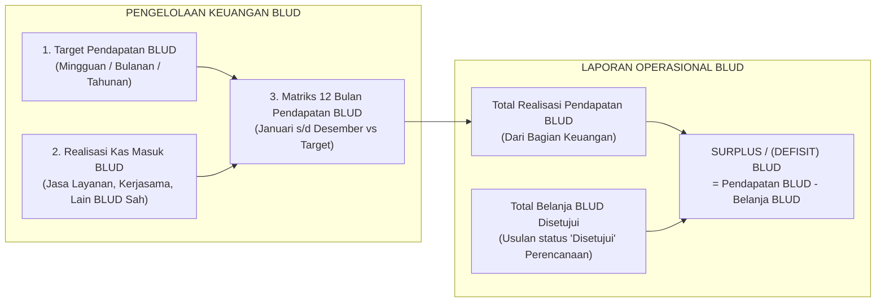

# [ISSUE / PLANNING] Penegasan Alur Khusus BLUD: Validasi Belanja RBA Unit oleh Perencanaan, Pembersihan Total Komponen Non-BLUD & Warisan, Manajemen Target Pendapatan Fleksibel BLUD, dan Matriks Realisasi 12 Bulan RS Jiwa Tampan

**Tipe**: Core BLUD Workflow Refactoring / Feature Expansion / Non-BLUD & Dead Code Purge  
**Prioritas**: P0 - Sangat Tinggi (*Critical Feedback Stakeholder - PPK-BLUD*)  
**Status**: Ready for Implementation  
**Label**: `blud-workflow`, `requisitions`, `code-cleanup`, `revenue-target`, `monthly-matrix`, `surplus-deficit`, `perencanaan`, `keuangan`  
**Target Pelaksana**: Junior Programmer & AI Model  
*(Dokumen ini merupakan spesifikasi teknis dan panduan implementasi komprehensif hasil revisi presentasi sistem dengan stakeholder E-BLUD RS Jiwa Tampan, menegaskan kepatuhan penuh terhadap tata kelola Pola Pengelolaan Keuangan Badan Layanan Umum Daerah / PPK-BLUD Permendagri No. 79/2018).*

---

## 1. Landasan Regulasi & Filosofi Alur Khusus BLUD

Sesuai regulasi **PP No. 23 Tahun 2005** dan **Permendagri No. 79 Tahun 2018 tentang Pola Pengelolaan Keuangan Badan Layanan Umum Daerah (PPK-BLUD)**, RS Jiwa Tampan memiliki status sebagai instansi BLUD penuh yang diberikan **fleksibilitas pengelolaan keuangan**. Ketentuan ini menjadi dasar fundamental dari restrukturisasi alur sistem:

### 1.1 Mengapa Alur Belanja Unit Tidak Lewat Bagian Keuangan?
1. **Fleksibilitas Penggunaan Langsung (*Direct Spending*)**:
   * Pendapatan fungsional jasa layanan dan kerjasama BLUD dapat digunakan secara langsung untuk membiayai belanja operasional pelayanan tanpa harus disetor terlebih dahulu ke Kas Daerah dan **tanpa memerlukan penerbitan SP2D (Surat Perintah Pencairan Dana) dari Bagian Keuangan / BUD**.
2. **Pengendalian Berada pada RBA (Rencana Bisnis dan Anggaran)**:
   * Pengendalian belanja operasional BLUD berada di bawah kendali **Bagian Perencanaan** melalui pagu akun RBA Belanja BLUD.
   * Usulan belanja unit (ruangan, instalasi, poli) titik akhirnya adalah **validasi kelayakan SSH dan ketersediaan sisa pagu rekening RBA oleh Bagian Perencanaan**.
   * Ketika Bagian Perencanaan memberikan persetujuan (**ACC Final / Status: Disetujui**), berkas tersebut sah memotong pagu RBA dan langsung diakui sebagai realisasi belanja BLUD.
   * Apabila pagu rekening belanja tidak mencukupi atau terjadi pergeseran kebutuhan mendesak antar-pos, Bagian Perencanaan memproses **RBA Pergeseran** sesuai batas fleksibilitas yang diatur peraturan kepala daerah/direktur.

### 1.2 Pemisahan Peran Fungsional BLUD (*Segregation of Duties*)
* **Bagian Perencanaan**:
  1. Menyusun dan mengelola pagu **RBA Belanja BLUD Murni** (`rba_accounts`).
  2. Melakukan telaah, validasi standar harga (SSH), dan memberikan **Persetujuan Final (ACC)** pengajuan belanja unit.
  3. Mengelola penyesuaian pagu belanja melalui **RBA Pergeseran** (`rba_shifts`).
* **Bagian Keuangan**:
  1. **TIDAK LAGI mengurusi antrean verifikasi atau pencairan berkas usulan belanja per unit**.
  2. Fokus mengelola kas dan likuiditas penerimaan: menyusun **Target Pendapatan BLUD** (fleksibel: per minggu, per bulan, atau per tahun).
  3. Mencatat seluruh transaksi kas masuk **Realisasi Pendapatan Fungsional BLUD** (jasa layanan medis, penunjang, farmasi, kerjasama diklat, jasa giro, dll.).
  4. Menyajikan **Matriks Rekapitulasi Realisasi Pendapatan BLUD 12 Bulan (Januari - Desember)**.
  5. Menyusun **Laporan Operasional Surplus / Defisit BLUD**:
     $$\text{Surplus / (Defisit) BLUD} = \text{Total Realisasi Pendapatan BLUD} - \text{Total Belanja BLUD Disetujui Perencanaan}$$

### 1.3 Eksklusif BLUD: Pembersihan Seluruh Pos & Istilah Non-BLUD
Aplikasi ini dirancang khusus untuk operasional **E-BLUD**, bukan sistem penatausahaan APBD umum Pemda (yang sudah terakomodasi di SIPD-RI). Oleh karena itu:
* Seluruh pos anggaran dan pendapatan non-BLUD seperti **Pendapatan dari APBD (Operasional/Investasi)** dan **Pendapatan dari APBN** **DIHAPUS DARI SISTEM**.
* Istilah warisan APBD seperti `SP2D`, `Nomor Kuitansi Kasda`, serta antrean `Diproses_Keuangan` dan `Disetujui_Selesai` **DIHAPUS TOTAL** dari basis data, controller, dan antarmuka pengguna.

---

## 2. Arsitektur Alur Bisnis Khusus BLUD (Sebelum vs Sesudah)

### 2.1 Diagram Alur Pengajuan Belanja Operasional BLUD

```mermaid
flowchart TD
    subgraph OLD["ALUR LAMA (SALAH - MEKANISME APBD WARISAN)"]
        direction TB
        O1["Unit Kerja Buat Usulan"] --> O2["Verifikasi Bag. Perencanaan"]
        O2 -->|Diteruskan| O3["Verifikasi Bag. Keuangan (DIHAPUS)"]
        O3 -->|Pencairan SP2D APBD (DIHAPUS)| O4["Selesai Cair (DIHAPUS)"]
    end

    subgraph NEW["ALUR BARU (BENAR - FLEKSIBILITAS PPK-BLUD)"]
        direction TB
        N1["Unit Kerja (Ruangan / Instalasi)<br/>Mengajukan Usulan Belanja BLUD"] --> N2["Bagian Perencanaan<br/>Telaah SSH & Sisa Pagu RBA Belanja"]
        N2 -->|Disetujui / ACC Final| N3["Status: Disetujui (Final Sah)<br/>Otomatis Memotong Pagu RBA BLUD"]
        N2 -->|Ditolak / Catatan Revisi| N4["Status: Ditolak<br/>Kembali ke Unit Kerja"]
        N3 -.->|Jika Pagu Kurang / Butuh Geser Pos| N5["Proses Fleksibilitas:<br/>RBA Pergeseran Antar-Akun"]
        
        N3 ==>|Otomatis Diakui Sebagai| N6["Realisasi Belanja BLUD<br/>(Sumber Data Laporan Surplus/Defisit)"]
    end
```

### 2.2 Diagram Alur Modul Keuangan BLUD (Pendapatan & Surplus-Defisit)



---

## 3. Rencana Pembersihan Total Komponen Non-BLUD & Warisan (*Purge Plan*)

Untuk mencegah bug runtime (seperti kasus `Column not found` pada query controller) dan membebaskan codebase dari *technical debt*, implementor wajib menghapus komponen berikut tanpa kompromi:

### 3.1 Pembersihan Basis Data (*Database Cleanup*)
Tabel `requisitions` dibersihkan dari atribut non-BLUD:
1. **Drop Kolom dari Tabel `requisitions`**:
   - `approved_by_keuangan_id` *(drop foreign key `requisitions_approved_by_keuangan_id_foreign` terlebih dahulu)*.
   - `approved_keuangan_at`.
   - `notes_keuangan`.
   - `sp2d_number`.
   - `receipt_number`.
2. **Pembersihan Enum Status `requisitions.status`**:
   - Update data lama sebelum alter table:
     ```sql
     UPDATE requisitions 
     SET status = 'Disetujui' 
     WHERE status IN ('Diproses_Keuangan', 'Disetujui_Selesai');
     ```
   - Skema enum baru yang bersih:
     ```sql
     ALTER TABLE requisitions MODIFY COLUMN status ENUM(
         'Draft',
         'Pending_Perencanaan',
         'Disetujui',
         'Ditolak'
     ) NOT NULL DEFAULT 'Pending_Perencanaan';
     ```

### 3.2 Pembersihan Kode Backend (*Backend Code Cleanup*)
1. **Hapus File Controller**:
   - Hapus permanen: `app/Http/Controllers/Keuangan/RequisitionController.php`.
2. **Hapus Rute Terkait di `routes/web.php`**:
   - Hapus seluruh route grup `keuangan.requisitions.*` (index, show, verify, disburse, print-sp2d).
3. **Pembersihan Model `app/Models/Requisition.php`**:
   - Hapus relasi `approvedByKeuangan()`.
   - Hapus atribut non-BLUD dari `$fillable` dan `$casts`.
   - Hapus konstanta `STATUS_DIPROSES_KEUANGAN` dan `STATUS_DISETUJUI_SELESAI`, gunakan `STATUS_DISETUJUI = 'Disetujui'`.
   - Helper `isApproved()`: cukup memeriksa `$this->status === self::STATUS_DISETUJUI`.
4. **Refactoring Controller Perencanaan (`Perencanaan/RequisitionController.php`)**:
   - Method `approve()`: ubah status menjadi **`Disetujui`** (final), langsung kurangi `remaining_budget` dan tambahkan `spent_budget` pada rekening belanja RBA `rba_accounts`.
5. **Pembersihan Monitoring & Super Admin**:
   - Pada `SuperAdmin/MonitoringController.php` & `DashboardController.php`:
     - Hapus eager load relasi `approvedByKeuangan`.
     - Hapus query status `Diproses_Keuangan` & `Disetujui_Selesai`, gantikan dengan `Disetujui`.

### 3.3 Pembersihan Antarmuka Pengguna (*Frontend UI Cleanup*)
1. **Hapus Folder Halaman**:
   - Hapus folder `resources/js/Pages/Keuangan/Requisitions/` beserta modal `FinanceDisbursementModal.jsx`.
2. **Pembersihan Layout Keuangan (`KeuanganLayout.jsx`)**:
   - Hapus menu "Validasi Requisition" / "Pencairan SP2D".
   - Pasang menu murni BLUD: **"Target Pendapatan BLUD"** dan **"Matriks Pendapatan 12 Bulan"**.
3. **Pembersihan Modul Unit Kerja (`Divisi/Requisitions/`)**:
   - Pada `Show.jsx`: Hapus Step 3 (Verifikasi Keuangan) pada stepper. Stepper hanya: `1. Pengajuan Usulan BLUD` &rarr; `2. Telaah & Pengesahan Perencanaan`. Hapus kartu rincian SP2D.
   - Pada `Index.jsx`: Hapus tab/filter `Diproses Keuangan` dan `Selesai Cair`.
4. **Pembersihan Tampilan Perencanaan (`Perencanaan/Requisitions/Show.jsx`)**:
   - Ubah tombol modal menjadi **"Setujui & Sahkan Belanja RBA BLUD"**.
5. **Pembersihan Monitoring Super Admin (`SuperAdmin/Monitoring/Requisitions.jsx`)**:
   - Hapus kolom `No. SP2D / Kuitansi` dan filter status lama.

---

## 4. Spesifikasi Modul Murni BLUD: Target Pendapatan Fleksibel (`revenue_targets`)

Bagian Keuangan menyusun target pendapatan fungsional BLUD yang fleksibel (tahunan, bulanan 12 bulan, atau mingguan).

### 4.1 Skema Tabel `revenue_targets`

```sql
CREATE TABLE revenue_targets (
    id BIGINT UNSIGNED AUTO_INCREMENT PRIMARY KEY,
    fiscal_year INT NOT NULL COMMENT 'Tahun Anggaran BLUD, contoh: 2027',
    account_code VARCHAR(50) NOT NULL COMMENT 'Kode Rekening BLUD e.g. 4.1.4.16 atau kode pos',
    account_name VARCHAR(255) NOT NULL COMMENT 'Uraian Pos Layanan / Pendapatan BLUD',
    category ENUM(
        'Jasa Layanan',
        'Hasil Kerjasama',
        'Hibah',
        'Lain-lain BLUD Sah'
    ) NOT NULL DEFAULT 'Jasa Layanan' COMMENT 'Kategori Murni BLUD (Non-APBD/APBN)',
    period_type ENUM('yearly', 'monthly', 'weekly') NOT NULL DEFAULT 'monthly' COMMENT 'Tipe alokasi target',
    target_yearly DECIMAL(18, 2) NOT NULL DEFAULT 0.00 COMMENT 'Total nominal target tahunan BLUD',
    
    -- Target per Bulan (Januari s/d Desember)
    target_jan DECIMAL(18, 2) NOT NULL DEFAULT 0.00,
    target_feb DECIMAL(18, 2) NOT NULL DEFAULT 0.00,
    target_mar DECIMAL(18, 2) NOT NULL DEFAULT 0.00,
    target_apr DECIMAL(18, 2) NOT NULL DEFAULT 0.00,
    target_may DECIMAL(18, 2) NOT NULL DEFAULT 0.00,
    target_jun DECIMAL(18, 2) NOT NULL DEFAULT 0.00,
    target_jul DECIMAL(18, 2) NOT NULL DEFAULT 0.00,
    target_aug DECIMAL(18, 2) NOT NULL DEFAULT 0.00,
    target_sep DECIMAL(18, 2) NOT NULL DEFAULT 0.00,
    target_oct DECIMAL(18, 2) NOT NULL DEFAULT 0.00,
    target_nov DECIMAL(18, 2) NOT NULL DEFAULT 0.00,
    target_dec DECIMAL(18, 2) NOT NULL DEFAULT 0.00,
    
    -- Breakdown target mingguan fleksibel
    weekly_breakdown JSON NULL COMMENT 'Breakdown mingguan format JSON: {"jan": [w1, w2, w3, w4], ...}',
    
    notes TEXT NULL,
    created_by BIGINT UNSIGNED NULL,
    updated_by BIGINT UNSIGNED NULL,
    created_at TIMESTAMP NULL DEFAULT CURRENT_TIMESTAMP,
    updated_at TIMESTAMP NULL ON UPDATE CURRENT_TIMESTAMP,
    
    CONSTRAINT fk_revenue_targets_creator FOREIGN KEY (created_by) REFERENCES users(id) ON DELETE SET NULL,
    CONSTRAINT fk_revenue_targets_updater FOREIGN KEY (updated_by) REFERENCES users(id) ON DELETE SET NULL,
    INDEX idx_revenue_targets_year_code (fiscal_year, account_code)
) ENGINE=InnoDB DEFAULT CHARSET=utf8mb4 COLLATE=utf8mb4_unicode_ci;
```

### 4.2 Struktur Rekening Murni Pendapatan BLUD RS Jiwa Tampan
*(Pos non-BLUD seperti APBD dan APBN telah dihapus 100% dari sistem)*:

| Kode Rekening | Level | Uraian Rekening Pendapatan BLUD | Kategori BLUD | Target Pagu (TA 2027) |
| :--- | :---: | :--- | :--- | :--- |
| **4** | 1 | **PENDAPATAN** | Root Akun 4 | Rp 32.469.887.914,00 |
| **4.1** | 2 | **PENDAPATAN ASLI DAERAH** | PAD | Rp 32.469.887.914,00 |
| **4.1.4** | 3 | **Lain-lain Pendapatan Asli Daerah yang Sah** | PAD Sah | Rp 32.469.887.914,00 |
| **4.1.4.16** | 4 | **Pendapatan BLUD** | Pendapatan BLUD | Rp 32.469.887.914,00 |
| - | 5 | **Pendapatan Jasa Layanan** | Header Jasa Layanan | Rp 31.393.537.914,00 |
| - | 6 | Pendapatan Pelayanan Gawat Darurat | Jasa Layanan | Rp 135.195.000,00 |
| - | 6 | Pendapatan Pelayanan Intensif/UPIP | Jasa Layanan | Rp 257.500.000,00 |
| - | 6 | Pendapatan Pelayanan Rawat Jalan | Jasa Layanan | Rp 7.521.895.000,00 |
| - | 6 | Pendapatan Pelayanan Rawat Inap | Jasa Layanan | Rp 18.608.697.914,00 |
| - | 6 | Pendapatan Pelayanan Rawat Inap-Napza | Jasa Layanan | Rp 750.000.000,00 |
| - | 6 | Pendapatan Pelayanan Rehabilitasi Psikososial | Jasa Layanan | Rp 0,00 |
| - | 6 | Pendapatan Pelayanan Psikologi | Jasa Layanan | Rp 625.000.000,00 |
| - | 6 | Pendapatan Pelayanan Konseling Keperawatan Jiwa | Jasa Layanan | Rp 13.000.000,00 |
| - | 6 | Pendapatan Pelayanan Forensik Psikiatri | Jasa Layanan | Rp 21.000.000,00 |
| - | 6 | Pendapatan Pelayanan Laboratorium | Jasa Layanan | Rp 500.000.000,00 |
| - | 6 | Pendapatan Pelayanan Radiologi | Jasa Layanan | Rp 28.750.000,00 |
| - | 6 | Pendapatan Pelayanan Gizi | Jasa Layanan | Rp 8.000.000,00 |
| - | 6 | Pendapatan Pelayanan Farmasi | Jasa Layanan | Rp 2.565.500.000,00 |
| - | 6 | Pendapatan Pelayanan Rekam Medik | Jasa Layanan | Rp 359.000.000,00 |
| - | 6 | Pendapatan Pelayanan Ambulance/Kereta Jenazah | Jasa Layanan | Rp 0,00 |
| - | 5 | **Hibah** | Header Hibah | Rp 0,00 |
| - | 5 | **Hasil Kerjasama** | Header Kerja Sama | Rp 376.350.000,00 |
| - | 6 | Hasil Kerjasama Diklat | Hasil Kerjasama | Rp 150.000.000,00 |
| - | 6 | Hasil Kerjasama Penggunaan Fasilitas RSJ Tampan | Hasil Kerjasama | Rp 226.350.000,00 |
| - | 5 | **Lain-lain Pendapatan BLUD yang Sah** | Header Lain-lain | Rp 700.000.000,00 |
| - | 6 | Jasa Giro Rekening BLUD | Lain-lain BLUD Sah | Rp 400.000.000,00 |
| - | 6 | Pendapatan Bunga Deposito BLUD | Lain-lain BLUD Sah | Rp 0,00 |
| - | 6 | Pendapatan Lain-Lain BLUD | Lain-lain BLUD Sah | Rp 300.000.000,00 |

### 4.3 Fitur Antarmuka Pengaturan Target (`Keuangan/RevenueTargets/Index.jsx`)
1. **Mode Tahunan**: Memasukkan target 1 tahun, disediakan tombol *"Bagi Rata ke 12 Bulan"* (`target_yearly / 12`).
2. **Mode Bulanan**: Mengisi spesifik per bulan (Januari s/d Desember), sistem otomatis menjumlahkan `target_yearly`.
3. **Mode Mingguan**: Pengaturan breakdown mingguan per bulan untuk proyeksi likuiditas fungsional BLUD.
4. **Agregasi Otomatis**: Pos induk (Jasa Layanan, Hasil Kerjasama, Lain-lain BLUD Sah, dan total `4.1.4.16 Pendapatan BLUD`) terkalkulasi otomatis.

---

## 5. Spesifikasi Matriks Realisasi Pendapatan BLUD 12 Bulan (Januari - Desember)

### 5.1 Format Matriks Bulanan (`Keuangan/Reports/RevenueMonthlyMatrix.jsx`)
Format tampilan tabel pendapatan fungsional BLUD:

```text
+---------------+------------------------+-------------------+---------------------+-----+----------------------+--------------------+--------------------+---------------+
| Kode Rekening | Uraian Pendapatan BLUD | Jumlah Anggaran   | REALISASI (Jan-Des) | ... | TOTAL REALISASI      | SISA ANGGARAN      | % Realisasi        |
| (1)           | (2)                    | (3) [Target]      | (4 s.d. 15)         | ... | (16 = SUM Jan..Des)  | (17 = Col 3 - 16)  | (18 = 16/3 * 100%) |
+---------------+------------------------+-------------------+---------------------+-----+----------------------+--------------------+--------------------+---------------+
| 4             | PENDAPATAN             | 32.469.887.914,00 | Jan: 2.193.463.410  | ... | 24.298.959.965,00    | (8.170.927.949,00) | 74,84%            |
| 4.1           | PENDAPATAN ASLI DAERAH | 32.469.887.914,00 | Jan: 2.193.463.410  | ... | 24.298.959.965,00    | (8.170.927.949,00) | 74,84%            |
| 4.1.4         | Lain-lain PAD yg Sah   | 32.469.887.914,00 | Jan: 2.193.463.410  | ... | 24.298.959.965,00    | (8.170.927.949,00) | 74,84%            |
| 4.1.4.16      | Pendapatan BLUD        | 32.469.887.914,00 | Jan: 2.193.463.410  | ... | 24.298.959.965,00    | (8.170.927.949,00) | 74,84%            |
|               | Pendapatan Jasa Layanan| 31.393.537.914,00 | Jan: 2.154.434.994  | ... | 23.856.954.615,00    | (7.536.583.299,00) | 75,99%            |
|               | Pelayanan Rawat Jalan  |  7.521.895.000,00 | Jan:   504.115.700  | ... |  3.460.744.137,00    | (4.061.150.863,00) | 46,01%            |
|               | Pelayanan Farmasi      |  2.565.500.000,00 | Jan:   114.655.237  | ... |  1.576.600.861,00    |   (988.899.139,00) | 61,45%            |
|               | Hasil Kerjasama Diklat |    150.000.000,00 | Jan:    32.450.000  | ... |    205.911.700,00    |     55.911.700,00  | 137,27%           |
|               | Jasa Giro Rekening BLUD|    400.000.000,00 | Jan:     3.965.007  | ... |     47.680.241,00    |   (352.319.759,00) | 11,92%            |
+---------------+------------------------+-------------------+---------------------+-----+----------------------+--------------------+--------------------+---------------+
| TOTAL PENDAPATAN BLUD                  | 32.469.887.914,00 |                     | ... | 24.298.959.965,00    | (8.170.927.949,00) | 74,84%            |
+---------------+------------------------+-------------------+---------------------+-----+----------------------+--------------------+--------------------+---------------+
```

### 5.2 Logika Perhitungan Kolom
1. **Jumlah Anggaran Target (Kolom 3)**:
   * Mengambil data `revenue_targets.target_yearly` untuk tahun fiskal aktif.
   * Baris induk level 1-4 diakumulasikan secara rekursif dari seluruh sub-pos BLUD di bawahnya.
2. **Realisasi Bulanan (Kolom 4 s/d 15: JAN - DES)**:
   * Mengagregasi nominal kas masuk dari tabel `revenues` per bulan:
     $$\text{Realisasi}(m) = \sum \text{amount} \quad \text{dimana } \text{MONTH}(date) = m \text{ dan } \text{YEAR}(date) = \text{active\_year}$$
3. **Total Realisasi (Kolom 16)**:
   $$\text{Total Realisasi} = \sum_{m=1}^{12} \text{Realisasi}(m)$$
4. **Sisa Anggaran Target (Kolom 17)**:
   $$\text{Sisa Anggaran} = \text{Jumlah Anggaran} - \text{Total Realisasi}$$
   *Aturan Tampilan Akuntansi*:
   * Jika nilai bernilai positif (target belum tercapai penuh), tampilkan dalam format tanda kurung: `(Rp xxx.xxx,xx)`.
   * Jika nilai negatif atau terlampaui (surplus target), tampilkan positif tanpa tanda kurung: `Rp xxx.xxx,xx`.
5. **Persentase Capaian (Kolom 18: % Realisasi)**:
   $$\% \text{ Realisasi} = \begin{cases} \left( \frac{\text{Total Realisasi}}{\text{Jumlah Anggaran}} \times 100\% \right), & \text{jika Jumlah Anggaran} > 0 \\ 0.00\%, & \text{jika Jumlah Anggaran} = 0 \end{cases}$$

### 5.3 Fasilitas Ekspor & Cetak
* **Ekspor Excel (.xlsx / .csv)**: Menyertakan seluruh kolom dan format angka akuntansi.
* **Cetak Resmi PDF/Print View**: Menggunakan layout lanskap (*A4/F4 Landscape*) dengan kop surat resmi Pemerintah Provinsi Riau - Rumah Sakit Jiwa Tampan, tanggal cetak dinamis, serta kolom tanda tangan Direktur dan Bendahara Penerimaan BLUD.

---

## 6. Spesifikasi Laporan Operasional Surplus / Defisit BLUD

Laporan Surplus/Defisit BLUD (`Keuangan/Reports/SurplusDeficit.jsx`) diperbarui untuk mengukur kinerja keuangan operasional BLUD murni:

### 6.1 Formula Perhitungan
$$\text{Surplus / (Defisit) BLUD} = \text{Total Realisasi Pendapatan BLUD} - \text{Total Belanja BLUD Disetujui}$$

* **Total Realisasi Pendapatan BLUD**: Akumulasi seluruh penerimaan kas masuk dari tabel `revenues` pada tahun aktif.
* **Total Belanja BLUD Disetujui**:
  ```php
  $totalBelanjaBLUD = (float) Requisition::where(function ($q) use ($activeYear) {
          $q->where('budget_year', $activeYear)->orWhere('fiscal_year', $activeYear);
      })
      ->where('status', 'Disetujui')
      ->sum('total_approved');
  ```

### 6.2 Indikator Status Finansial BLUD
* **SURPLUS OPERASIONAL BLUD**: Jika `Pendapatan BLUD >= Belanja BLUD` (Badge Hijau Emerald). Menunjukkan pendapatan layanan mampu menutup seluruh belanja operasional.
* **DEFISIT OPERASIONAL BLUD**: Jika `Pendapatan BLUD < Belanja BLUD` (Badge Merah Rose, nilai defisit dalam kurung). Menunjukkan perlunya evaluasi efisiensi belanja RBA atau intensifikasi pendapatan layanan.

---

## 7. Inventaris Komponen: Dibuat, Diubah, dan Dihapus

### 7.1 Komponen Non-BLUD & Warisan yang DIHAPUS TOTAL (Purged)

| No | File / Objek | Layer | Alasan Penghapusan |
| :--- | :--- | :---: | :--- |
| 1 | `app/Http/Controllers/Keuangan/RequisitionController.php` | Backend Controller | **DEAD CODE**. Keuangan tidak lagi memverifikasi usulan belanja unit di BLUD. |
| 2 | `routes/web.php` (rute `keuangan.requisitions.*`) | Backend Route | **DEAD ROUTE**. Rute pencairan belanja unit dihapus tuntas. |
| 3 | `resources/js/Pages/Keuangan/Requisitions/` *(seluruh isi folder)* | Frontend View | **DEAD VIEW**. Halaman antrean dan verifikasi belanja unit dihapus tuntas. |
| 4 | `resources/js/Pages/Keuangan/Requisitions/Partials/FinanceDisbursementModal.jsx` | Frontend Component | **DEAD COMPONENT**. Modal pencairan SP2D non-BLUD tidak digunakan lagi. |
| 5 | Kolom `approved_by_keuangan_id`, `approved_keuangan_at`, `notes_keuangan`, `sp2d_number`, `receipt_number` | Database Schema | **DEAD SCHEMA**. Atribut SP2D non-BLUD dihapus dari tabel `requisitions`. |
| 6 | Nilai Enum `Diproses_Keuangan` dan `Disetujui_Selesai` pada `requisitions.status` | Database Schema | **DEAD ENUM**. Disederhanakan menjadi `Disetujui` (final Perencanaan). |
| 7 | Pos Anggaran `Pendapatan dari APBD` & `Pendapatan dari APBN` | Domain Data | **NON-BLUD DATA**. Dihapus dari seeder, target, dan tampilan matriks 12 bulan. |

### 7.2 Komponen Baru yang DIBUAT (Created)

| No | File Path | Layer | Deskripsi & Fungsi |
| :--- | :--- | :---: | :--- |
| 1 | `database/migrations/xxxx_xx_xx_cleanup_requisitions_and_update_status_enum.php` | Database | Migration drop kolom SP2D warisan dan memperbarui enum status `requisitions`. |
| 2 | `database/migrations/xxxx_xx_xx_create_revenue_targets_table.php` | Database | Migration untuk tabel baru `revenue_targets` (kategori murni BLUD). |
| 3 | `database/seeders/RevenueTargetSeeder.php` | Database | Seeder target pendapatan BLUD default RSJ Tampan TA 2027 (Rp 32.469.887.914,00). |
| 4 | `app/Models/RevenueTarget.php` | Eloquent Model | Model target pendapatan BLUD beserta casts, helper, dan scope tahun fiskal. |
| 5 | `app/Http/Controllers/Keuangan/RevenueTargetController.php` | Backend Controller | Controller penyusunan target pendapatan BLUD per rekening. |
| 6 | `resources/js/Pages/Keuangan/RevenueTargets/Index.jsx` | Frontend View | Form pengaturan target pendapatan BLUD (Tahunan, Bulanan, Mingguan). |
| 7 | `resources/js/Pages/Keuangan/Reports/RevenueMonthlyMatrix.jsx` | Frontend View | Tabel matriks realisasi pendapatan BLUD 12 bulan (Jan-Des), ekspor Excel, dan cetak. |
| 8 | `resources/js/Pages/Shared/PrintRevenueMonthlyMatrix.jsx` | Frontend View | Template cetak laporan matriks 12 bulan ber-kop resmi RS Jiwa Tampan (Landscape). |
| 9 | `tests/Feature/RevenueWorkflowAndCleanupTest.php` | Automated Test | Pengujian alur belanja BLUD, target pendapatan BLUD, dan matriks 12 bulan. |

### 7.3 Komponen yang DIMODIFIKASI (Updated)

| No | File Path | Layer | Rangkuman Perubahan |
| :--- | :--- | :---: | :--- |
| 1 | `app/Models/Requisition.php` | Backend Model | Hapus relasi `approvedByKeuangan`, bersihkan `$fillable`, sesuaikan status BLUD. |
| 2 | `app/Http/Controllers/Perencanaan/RequisitionController.php` | Backend Controller | Status approval langsung `Disetujui`, mutasikan sisa pagu `rba_accounts`. |
| 3 | `app/Http/Controllers/Keuangan/ReportController.php` | Backend Controller | Tambahkan method `revenueMonthlyMatrix()`, perbarui formula Surplus/Defisit BLUD. |
| 4 | `app/Http/Controllers/Divisi/RequisitionController.php` | Backend Controller | Bersihkan filter `Diproses_Keuangan`. |
| 5 | `app/Http/Controllers/SuperAdmin/MonitoringController.php` | Backend Controller | Hapus relasi keuangan lama, perbarui filter status. |
| 6 | `resources/js/Layouts/KeuanganLayout.jsx` | Frontend Layout | Hapus menu validasi belanja, pasang menu Target Pendapatan & Matriks 12 Bulan BLUD. |
| 7 | `resources/js/Pages/Divisi/Requisitions/Index.jsx` & `Show.jsx` | Frontend View | Hapus stepper step 3 dan kolom SP2D, tampilkan status final `Disetujui`. |
| 8 | `resources/js/Pages/Perencanaan/Requisitions/Show.jsx` | Frontend View | Ubah tombol menjadi "Setujui & Sahkan Belanja RBA BLUD". |
| 9 | `resources/js/Pages/Keuangan/Reports/SurplusDeficit.jsx` | Frontend View | Hitung Surplus/Defisit operasional BLUD murni. |
| 10| `resources/js/Pages/SuperAdmin/Monitoring/Requisitions.jsx` | Frontend View | Hapus kolom SP2D dan filter lama. |

---

## 8. Panduan Langkah demi Langkah (*Step-by-Step Implementation Guide*)

Junior Programmer atau AI Model wajib mengeksekusi tahapan ini secara berurutan:

### Tahap 1: Pembersihan Skema Basis Data & Migrasi Khusus BLUD
1. Buat migration `cleanup_requisitions_and_update_status_enum`:
   - Migrasi data lama: ubah status `Diproses_Keuangan` dan `Disetujui_Selesai` menjadi `Disetujui`.
   - Drop foreign key `requisitions_approved_by_keuangan_id_foreign`.
   - Drop kolom `approved_by_keuangan_id`, `approved_keuangan_at`, `notes_keuangan`, `sp2d_number`, `receipt_number`.
   - Modifikasi enum `status` menjadi `['Draft', 'Pending_Perencanaan', 'Disetujui', 'Ditolak']`.
2. Buat migration `create_revenue_targets_table` sesuai Bagian 4.1 (kategori murni BLUD).
3. Buat seeder `RevenueTargetSeeder.php` dengan data riil BLUD RS Jiwa Tampan (Total target Rp 32.469.887.914,00 tanpa pos APBD/APBN).
4. Jalankan `php artisan migrate` dan `php artisan db:seed --class=RevenueTargetSeeder`.

### Tahap 2: Pembersihan Backend & Refactor Approval Belanja RBA BLUD
1. Hapus file `app/Http/Controllers/Keuangan/RequisitionController.php`.
2. Buka `routes/web.php`: hapus seluruh rute `keuangan.requisitions.*`.
3. Buka `app/Models/Requisition.php`: bersihkan relasi `approvedByKeuangan`, fillable, cast, dan perbarui konstanta status.
4. Buka `app/Http/Controllers/Perencanaan/RequisitionController.php`:
   - Saat approval di-submit, set `status = 'Disetujui'`, kurangi `remaining_budget` dan tambahkan `spent_budget` pada `rba_accounts`.
5. Buka `app/Http/Controllers/SuperAdmin/MonitoringController.php` & `DashboardController.php`: bersihkan eager load dan query status lama.

### Tahap 3: Pembersihan Antarmuka Pengguna (UI)
1. Hapus folder `resources/js/Pages/Keuangan/Requisitions/` beserta isinya.
2. Edit `resources/js/Layouts/KeuanganLayout.jsx`: buang menu validasi belanja, pasang menu Target Pendapatan BLUD dan Matriks 12 Bulan BLUD.
3. Edit `resources/js/Pages/Divisi/Requisitions/Show.jsx` & `Index.jsx`: buang step 3 stepper dan kolom SP2D, tampilkan status sah disetujui Perencanaan.
4. Edit `resources/js/Pages/Perencanaan/Requisitions/Show.jsx`: tombol ACC final mandiri belanja RBA.
5. Edit `resources/js/Pages/SuperAdmin/Monitoring/Requisitions.jsx`: bersihkan filter dan kolom SP2D.

### Tahap 4: Implementasi Modul Target Pendapatan BLUD
1. Buat model `app/Models/RevenueTarget.php`.
2. Buat controller `app/Http/Controllers/Keuangan/RevenueTargetController.php` dengan rute `GET /keuangan/revenue-targets` dan `POST /keuangan/revenue-targets`.
3. Buat view `resources/js/Pages/Keuangan/RevenueTargets/Index.jsx` lengkap dengan tab alokasi (Tahunan, Bulanan, Mingguan) dan kalkulator bagi rata.

### Tahap 5: Implementasi Matriks Realisasi Pendapatan BLUD 12 Bulan (Jan - Des)
1. Pada `app/Http/Controllers/Keuangan/ReportController.php`, buat method `revenueMonthlyMatrix()`:
   - Ambil target dari `revenue_targets` (khusus pos BLUD).
   - Agregasi realisasi dari `revenues` per bulan (Januari s/d Desember).
   - Hitung total realisasi, sisa anggaran (dengan format kurung untuk sisa belum tercapai), dan % realisasi.
2. Buat view `resources/js/Pages/Keuangan/Reports/RevenueMonthlyMatrix.jsx`.
3. Buat template cetak `resources/js/Pages/Shared/PrintRevenueMonthlyMatrix.jsx` (Lanskap dengan kop resmi RS Jiwa Tampan).
4. Sediakan fitur ekspor Excel.

### Tahap 6: Rekalkulasi Laporan Surplus / Defisit BLUD
1. Pada `app/Http/Controllers/Keuangan/ReportController.php::surplusDeficit()`:
   - Hitung belanja dari seluruh usulan yang berstatus `'Disetujui'` oleh Perencanaan.
   - Hitung selisih: $\text{Pendapatan BLUD} - \text{Belanja BLUD Disetujui}$.
2. Perbarui tampilan `resources/js/Pages/Keuangan/Reports/SurplusDeficit.jsx`.

### Tahap 7: Harmonisasi & Pengujian Menyeluruh (*Testing & Verification*)
1. Tambahkan feature test di `tests/Feature/RevenueWorkflowAndCleanupTest.php`.
2. Jalankan `php artisan test` & pastikan semua test lulus 100%.
3. Jalankan `npm run build` & pastikan aset terkompilasi bersih tanpa peringatan.

---

## 9. Kriteria Penerimaan (*Acceptance Criteria*)

- [ ] **Murni Khusus Pengelolaan BLUD**: Seluruh pos anggaran dan terminologi non-BLUD (APBD, APBN, SP2D Kasda) tidak ada lagi di sistem. Aplikasi 100% berfokus pada fleksibilitas PPK-BLUD Permendagri No. 79/2018.
- [ ] **Dead Code & Dead Columns Dihapus Tuntas (0% Sisa)**:
  - File `Keuangan/RequisitionController.php` dan folder `resources/js/Pages/Keuangan/Requisitions/` sudah terhapus permanen.
  - Rute `keuangan.requisitions.*` tidak lagi terdaftar di sistem (`php artisan route:list` bersih).
  - Kolom `approved_by_keuangan_id`, `approved_keuangan_at`, `notes_keuangan`, `sp2d_number`, `receipt_number` sudah tidak ada di tabel `requisitions`.
  - Enum `status` pada tabel `requisitions` murni hanya: `'Draft'`, `'Pending_Perencanaan'`, `'Disetujui'`, `'Ditolak'`.
- [ ] **Alur Usulan Belanja Berhenti di Perencanaan**: Usulan belanja operasional BLUD divalidasi dan disahkan final oleh Perencanaan (status langsung `Disetujui`), tanpa antrean ke Keuangan.
- [ ] **Pemotongan Pagu RBA Belanja Otomatis**: Ketika Perencanaan menyetujui usulan, `remaining_budget` rekening belanja RBA langsung berkurang dan `spent_budget` bertambah.
- [ ] **Modul Target Pendapatan BLUD Aktif & Fleksibel**: Bagian Keuangan dapat mengatur target pendapatan BLUD per rekening dengan alokasi tahunan, bulanan (12 bulan), maupun mingguan.
- [ ] **Matriks 12 Bulan Sesuai Dokumen Riil RSJ**: Tabel Matriks Realisasi Pendapatan Bulanan berhasil merender pos pendapatan BLUD murni, 12 kolom bulan (Januari s/d Desember), total realisasi, sisa anggaran target, dan persentase capaian (% Realisasi).
- [ ] **Formula Surplus-Defisit BLUD Akurat**: Laporan Surplus-Defisit menghitung `Total Realisasi Kas Pendapatan BLUD` dikurangi `Total Belanja BLUD Usulan yang Telah Disetujui Perencanaan`.
- [ ] **Cetak & Ekspor Berfungsi**: Dokumen Matriks 12 Bulan dapat dicetak rapi dalam mode cetak lanskap (*A4/F4 Landscape*) dengan kop surat resmi RSJ Tampan dan diekspor ke Excel.
- [ ] **Zero Regressions**: Seluruh automated tests (`php artisan test`) lulus 100% dan aset Vite (`npm run build`) terkompilasi bersih.
