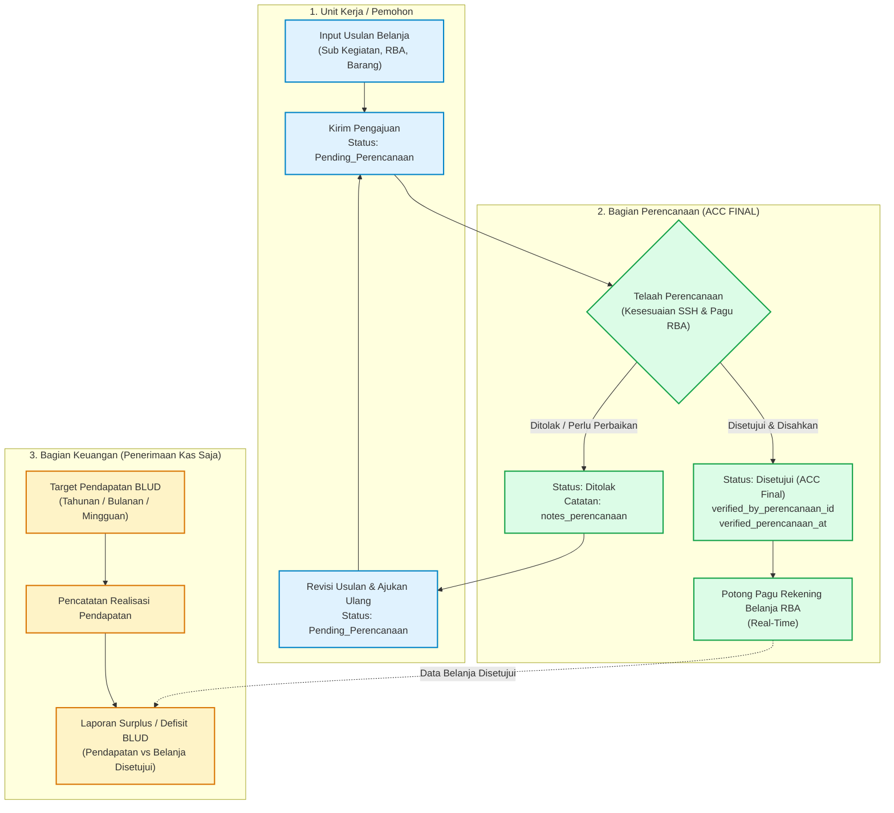

# Perencanaan Implementasi: Pembersihan Residu Alur Keuangan pada Modul Pengajuan Belanja

> **Target Pengembang**: Junior Programmer & AI Assistant Model  
> **Repository**: `rsj-req-app` (E-BLUD RS Jiwa Tampan Provinsi Riau)  
> **Status Dokumen**: Siap Diimplementasikan (*Ready for Implementation*)  
> **Branch Terkait**: `perbaikan_alur`  

---

## 1. Konteks & Latar Belakang Perubahan

Pada sistem E-BLUD RS Jiwa Tampan sebelumnya, usulan belanja logistik/barang dari Unit Kerja melalui alur 3 tahap:
$$\text{Unit Pengusul} \longrightarrow \text{Bagian Perencanaan} \longrightarrow \text{Bagian Keuangan (Penerbitan SP2D \& Kuitansi)}$$

Berdasarkan hasil evaluasi dan revisi tata kelola BLUD rumah sakit yang telah disepakati:
1. **Bagian Keuangan TIDAK LAGI** menjadi verifikator ataupun gerbang persetujuan pencairan SP2D untuk berkas usulan belanja (*requisition*). Keuangan difokuskan sepenuhnya pada **Target Pendapatan BLUD**, **Pencatatan Realisasi Penerimaan Kas Masuk**, dan **Laporan Akuntabilitas Kas/Surplus-Defisit**.
2. **Alur Resmi Usulan Belanja** disederhanakan menjadi **2 Tahap Penuh**:
   $$\text{Unit Pengusul (Draft/Diajukan)} \longrightarrow \text{Bagian Perencanaan (Telaah SSH, Kuantitas, \& ACC Final Pagu RBA)}$$
3. Ketika Bagian Perencanaan menyetujui usulan belanja, status langsung menjadi **`'Disetujui'` (ACC Final)** dan saldo pagu rekening belanja RBA BLUD langsung terpotong secara *real-time*.

### Permasalahan Saat Ini (*Current Problem*)
Meskipun alur backend utama telah diperbarui ke status `'Disetujui'`, audit mendalam menemukan **residu (sisa-sisa tampilan, filter dropdown, teks label, dan pesan validasi controller)** yang masih menampilkan/menyebutkan *"Keuangan"*, *"Disetujui oleh Keuangan"*, *"Diteruskan ke Keuangan"*, dan filter status usang (`Diproses_Keuangan` / `Disetujui_Selesai`).

Dampaknya:
1. **Sidebar Perencanaan & Divisi/Unit**: Masih terdapat menu anak (*sub-menu*) *"Diteruskan ke Keuangan"* dan *"Disetujui Selesai"*. Ketika diklik, tabel menampilkan 0 data karena berkas baru berstatus `'Disetujui'`, bukan `'Disetujui_Selesai'` atau `'Diproses_Keuangan'`.
2. **Halaman Perencanaan RBA (Tab 4)**: Tombol filter dan judul tab masih bertuliskan *"Disetujui Keuangan"*, dan item belanja berstatus `'Disetujui'` tidak muncul akibat filter JavaScript yang hanya memeriksa `'Disetujui_Selesai'`.
3. **Pesan Validasi Controller**: Pada saat unit mencoba mengedit usulan yang sudah disahkan, controller mengeluarkan pesan error: *"Usulan belanja tidak dapat diubah karena telah diproses atau disetujui oleh Tim Keuangan."*
4. **Dashboard Super Admin & Modal**: Masih terdapat kartu metrik *"Diproses Bagian Keuangan"* dan placeholder instruksi *"Tuliskan catatan teknis untuk Bagian Keuangan"*.

---

## 2. Diagram Alur Sistem yang Benar (Target State)



---

## 3. Daftar File yang Perlu Dimodifikasi

Berikut adalah daftar berkas yang teridentifikasi memuat residu alur keuangan:

| No | File Path | Tipe | Lokasi / Baris | Deskripsi Perbaikan |
|---|---|---|---|---|
| 1 | `resources/js/Layouts/PerencanaanLayout.jsx` | UI Sidebar | ~100–125 | Hapus submenu *'Diteruskan ke Keuangan'*; Ubah *'Disetujui Selesai'* menjadi *'Disetujui (ACC Final)'* dengan parameter status `'Disetujui'`. |
| 2 | `resources/js/Layouts/DivisiLayout.jsx` | UI Sidebar | ~210–237 | Hapus submenu *'Diproses Keuangan'*; Ubah *'Disetujui Selesai'* menjadi *'Disetujui (ACC Final)'* dengan parameter status `'Disetujui'`. |
| 3 | `resources/js/Layouts/KeuanganLayout.jsx` | UI Layout | ~170–178 | Bersihkan branch `statusVal === 'Diproses_Keuangan'` dan `'Disetujui_Selesai'` dari deteksi URL submenu. |
| 4 | `app/Http/Controllers/Divisi/RequisitionController.php` | Backend Controller | ~358 | Perbarui pesan validasi saat usulan tidak boleh diedit: ganti *"disetujui oleh Tim Keuangan"* menjadi *"disetujui oleh Tim Perencanaan"*. |
| 5 | `resources/js/Pages/Perencanaan/RBA/Index.jsx` | Frontend View | ~331, 1822, 1849, 1938, 2049, 2082, 2193 | Ubah Tab 4 & pill filter dari *"Disetujui Keuangan"* menjadi *"Disetujui (ACC Final)"*. Dukung filter status `'Disetujui'` dan `'Disetujui_Selesai'`. |
| 6 | `resources/js/Pages/Perencanaan/RBA/PrintRincianBelanja.jsx` | Cetak Dokumen | ~28 | Perbarui filter cetak agar mencakup `it.status === 'Disetujui'`. |
| 7 | `resources/js/Pages/Perencanaan/Requisitions/Partials/QuickVerificationModal.jsx` | Modal Dialog | ~459 | Ubah placeholder textarea catatan verifikasi dari *"Bagian Keuangan atau unit pengusul"* menjadi *"unit kerja pengusul"*. |
| 8 | `resources/js/Pages/Divisi/Dashboard.jsx` | Frontend View | ~137 | Ubah banner catatan revisi dari *"Perencanaan atau Keuangan"* menjadi *"Tim Perencanaan"*. |
| 9 | `resources/js/Pages/SuperAdmin/Dashboard.jsx` | Frontend View | ~158, 348–365 | Ganti metrik *"Usulan Selesai SP2D"* menjadi *"Usulan Belanja Disetujui"*; Hapus card *"Diproses Bagian Keuangan"*; Tampilkan metrik akurat 3 status (`pending_perencanaan`, `disetujui`, `ditolak`). |
| 10 | `tests/Feature/RevenueWorkflowAndCleanupTest.php` | Automated Test | Akhir berkas | Tambahkan unit test untuk memastikan submenu status filter bekerja dan pesan validasi controller akurat. |

---

## 4. Panduan Implementasi Langkah demi Langkah (*Step-by-Step Guide*)

### Langkah 1: Perbaikan Sidebar Navigasi Perencanaan (`PerencanaanLayout.jsx`)
Buka file `resources/js/Layouts/PerencanaanLayout.jsx`. Pada konfigurasi menu `Verifikasi Pengajuan` (sekitar baris 100–125):

**Sebelum:**
```javascript
children: [
    {
        name: 'Semua Usulan',
        href: route('perencanaan.requisitions.index'),
        isActive: (url) => !url.includes('status='),
    },
    {
        name: 'Menunggu Telaah',
        href: route('perencanaan.requisitions.index', { status: 'Pending_Perencanaan' }),
        isActive: (url) => url.includes('status=Pending_Perencanaan'),
    },
    {
        name: 'Diteruskan ke Keuangan',
        href: route('perencanaan.requisitions.index', { status: 'Diproses_Keuangan' }),
        isActive: (url) => url.includes('status=Diproses_Keuangan'),
    },
    {
        name: 'Disetujui Selesai',
        href: route('perencanaan.requisitions.index', { status: 'Disetujui_Selesai' }),
        isActive: (url) => url.includes('status=Disetujui_Selesai'),
    },
    {
        name: 'Ditolak',
        href: route('perencanaan.requisitions.index', { status: 'Ditolak' }),
        isActive: (url) => url.includes('status=Ditolak'),
    },
]
```

**Sesudah:**
```javascript
children: [
    {
        name: 'Semua Usulan',
        href: route('perencanaan.requisitions.index'),
        isActive: (url) => !url.includes('status='),
    },
    {
        name: 'Menunggu Telaah',
        href: route('perencanaan.requisitions.index', { status: 'Pending_Perencanaan' }),
        isActive: (url) => url.includes('status=Pending_Perencanaan'),
    },
    {
        name: 'Disetujui (ACC Final)',
        href: route('perencanaan.requisitions.index', { status: 'Disetujui' }),
        isActive: (url) => url.includes('status=Disetujui'),
    },
    {
        name: 'Ditolak',
        href: route('perencanaan.requisitions.index', { status: 'Ditolak' }),
        isActive: (url) => url.includes('status=Ditolak'),
    },
]
```

> **Catatan Pengembang**: Di `Perencanaan/Requisitions/Index.jsx`, pastikan filter status URL mengenali `'Disetujui'`:
> Jika `statusFilter === 'Disetujui'`, usulan dengan status `'Disetujui'` maupun legacy `'Disetujui_Selesai'` harus dapat ditampilkan.

---

### Langkah 2: Perbaikan Sidebar Navigasi Divisi / Unit (`DivisiLayout.jsx`)
Buka file `resources/js/Layouts/DivisiLayout.jsx`. Pada bagian sub-menu dropdown usulan belanja (sekitar baris 210–237):

**Sebelum:**
```jsx
<Link
    href={route('requisitions.index', { status: 'Diproses_Keuangan' })}
    onClick={() => setSidebarOpen(false)}
    className={`...`}
>
    <span className="h-1.5 w-1.5 rounded-full bg-blue-500" />
    <span className="truncate">Diproses Keuangan</span>
</Link>

<Link
    href={route('requisitions.index', { status: 'Disetujui_Selesai' })}
    onClick={() => setSidebarOpen(false)}
    className={`...`}
>
    <span className="h-1.5 w-1.5 rounded-full bg-emerald-500" />
    <span className="truncate">Disetujui Selesai</span>
</Link>
```

**Sesudah:**
Hapus link *"Diproses Keuangan"*. Ganti link *"Disetujui Selesai"* menjadi *"Disetujui (ACC Final)"* dengan parameter `{ status: 'Disetujui' }`:
```jsx
<Link
    href={route('requisitions.index', { status: 'Disetujui' })}
    onClick={() => setSidebarOpen(false)}
    className={`flex items-center gap-2 rounded-lg py-1.5 px-2.5 text-xs transition-colors ${
        isRequisitionsActive && (currentStatus === 'Disetujui' || currentStatus === 'Disetujui_Selesai')
            ? 'bg-teal-100/80 text-teal-900 font-bold'
            : 'text-slate-600 hover:bg-teal-50 hover:text-teal-800 font-medium'
    }`}
>
    <span className="h-1.5 w-1.5 rounded-full bg-teal-500" />
    <span className="truncate">Disetujui (ACC Final)</span>
</Link>
```

---

### Langkah 3: Perbaikan Pesan Validasi Controller (`Divisi/RequisitionController.php`)
Buka `app/Http/Controllers/Divisi/RequisitionController.php`. Periksa baris 357–360:

**Sebelum:**
```php
if (! in_array($requisition->status, ['Pending_Perencanaan', 'Ditolak'])) {
    return back()->with('error', 'Usulan belanja tidak dapat diubah karena telah diproses atau disetujui oleh Tim Keuangan.');
}
```


**Sesudah:**
```php
if (! in_array($requisition->status, ['Pending_Perencanaan', 'Ditolak'])) {
    return back()->with('error', 'Usulan belanja tidak dapat diubah karena telah disetujui atau disahkan oleh Tim Perencanaan.');
}
```

---

### Langkah 4: Perbaikan Tab 4 Rincian Usulan Belanja RBA (`Perencanaan/RBA/Index.jsx`)
Buka `resources/js/Pages/Perencanaan/RBA/Index.jsx`. Lakukan penyesuaian pada bagian berikut:

1. **Logika Filter Usulan Aktif (Line ~330–335)**:
   ```javascript
   // Sebelum:
   if (statusFilter === 'DISETUJUI') {
       return it.status === 'Disetujui_Selesai';
   }

   // Sesudah:
   if (statusFilter === 'DISETUJUI') {
       return it.status === 'Disetujui' || it.status === 'Disetujui_Selesai';
   }
   ```
2. **Komentar & Header Tab 4 (Line ~1822)**:
   Ganti komentar header dari:
   `{/* TAB 4: RINCIAN USULAN BELANJA UNIT KERJA (DISETUJUI KEUANGAN) */}`
   menjadi:
   `{/* TAB 4: RINCIAN USULAN BELANJA UNIT KERJA (DISETUJUI PERENCANAAN / ACC FINAL) */}`
3. **Tombol Pill Filter (Line ~1849)**:
   Ganti teks tombol dari:
   `Disetujui Keuangan`
   menjadi:
   `Disetujui (ACC Final)`
4. **Pesan Kosong & Status Badges (Line ~1938, 2049, 2082, 2193)**:
   Ganti redaksi *"disetujui Keuangan"* menjadi *"disetujui Perencanaan"*.
   Pada badge status barang:
   ```javascript
   // Sebelum:
   item.status === 'Disetujui_Selesai'
       ? 'Disetujui Keuangan'
       : item.status === 'Diproses_Keuangan'
       ? 'Diproses Keuangan'
       : 'Menunggu Telaah'

   // Sesudah:
   item.status === 'Disetujui' || item.status === 'Disetujui_Selesai'
       ? 'Disetujui (ACC Final)'
       : item.status === 'Ditolak'
       ? 'Ditolak'
       : 'Menunggu Telaah'
   ```

---

### Langkah 5: Perbaikan Dokumen Cetak RBA (`PrintRincianBelanja.jsx`)
Buka `resources/js/Pages/Perencanaan/RBA/PrintRincianBelanja.jsx`.
Pada baris ~28:
```javascript
// Sebelum:
const activeItems = rawItems.filter((it) => it && (it.status === 'Disetujui_Selesai' || !it.status));

// Sesudah:
const activeItems = rawItems.filter((it) => it && (it.status === 'Disetujui' || it.status === 'Disetujui_Selesai' || !it.status));
```

---

### Langkah 6: Pembersihan Salinan Teks (Copywriting) pada Modal & Dashboard
1. **Modal Telaah Cepat (`QuickVerificationModal.jsx` Line ~459)**:
   Ganti placeholder:
   `placeholder="Tuliskan catatan telaah atau arahan teknis untuk unit kerja pengusul..."`
2. **Dashboard Divisi (`Divisi/Dashboard.jsx` Line ~137)**:
   Ganti teks alert revisi:
   `"Silakan periksa catatan telaah dari Tim Perencanaan."`
3. **Dashboard Super Admin (`SuperAdmin/Dashboard.jsx` Lines ~158, 348–365)**:
   - Ganti teks: `{kpi_keuangan.disetujui ?? 0} Usulan Belanja Disetujui` (hapus teks SP2D).
   - Hapus baris *Diproses Bagian Keuangan*.
   - Sesuaikan blok status menjadi 3 baris:
     * Menunggu Telaah Perencanaan (`kpi_perencanaan.pending_perencanaan`)
     * Disetujui (ACC Final) (`kpi_keuangan.disetujui`)
     * Ditolak / Perlu Revisi (`kpi_keuangan.ditolak`)

---

## 5. Rencana Pengujian & Verifikasi (*Quality Assurance*)

Setelah perubahan kode selesai, pengembang atau model AI wajib menjalankan verifikasi bertingkat berikut:

### 1. Uji Kompilasi Aset Frontend
Pastikan tidak ada error kompilasi JSX/Tailwind:

```sh
npm run build
```
*Hasil yang diharapkan: Built in < 3s, zero warnings/errors.*

### 2. Uji Otomatis Backend (PHPUnit)
Jalankan seluruh test suite aplikasi:
```sh
php artisan test
```

*Hasil yang diharapkan: Seluruh 205+ tes lulus 100% tanpa ada assertion failure.*

### 3. Skenario Uji Verifikasi Peran (Manual / End-to-End)

| Peran (Role) | Halaman / Fitur | Tindakan Uji | Hasil yang Diharapkan |
|---|---|---|---|
| **Staf Unit (Divisi)** | Sidebar Menu Navigasi | Klik menu *"Pengajuan Belanja"* | Submenu hanya ada 4: *Semua Pengajuan*, *Menunggu Telaah*, *Disetujui (ACC Final)*, *Perlu Perbaikan / Ditolak*. Tidak ada *"Diproses Keuangan"*. |
| **Staf Unit (Divisi)** | Filter *"Disetujui (ACC Final)"* | Klik link submenu *"Disetujui (ACC Final)"* | Menampilkan seluruh berkas usulan berstatus `'Disetujui'`. |
| **Staf Unit (Divisi)** | Validasi Edit Usulan Disetujui | Akses route update pada usulan yang telah disetujui | Pesan error backend menyatakan: *"Usulan belanja tidak dapat diubah karena telah disetujui atau disahkan oleh Tim Perencanaan."* |
| **Perencanaan** | Sidebar Menu Navigasi | Buka menu *"Verifikasi Pengajuan"* | Submenu hanya ada 4: *Semua Usulan*, *Menunggu Telaah*, *Disetujui (ACC Final)*, *Ditolak*. Tidak ada *"Diteruskan ke Keuangan"*. |
| **Perencanaan** | Modul RBA (Tab 4) | Klik Tab 4 *"Rincian Usulan Belanja"* | Header & tombol bertuliskan *"Disetujui (ACC Final)"*. Seluruh item usulan yang disahkan muncul dengan benar. |
| **Super Admin** | Dashboard (`/super-admin/dashboard`) | Periksa kartu status usulan | Tidak ada lagi status *"Diproses Bagian Keuangan"*. Angka *"Disetujui"* sesuai dengan data riil. |

---

## 6. Definisi Selesai (*Definition of Done*)

Pekerjaan dinyatakan selesai jika dan hanya jika:
- [ ] Sub-menu sidebar pada `PerencanaanLayout.jsx` dan `DivisiLayout.jsx` bersih dari kata *Keuangan* dan filter `Diproses_Keuangan`.
- [ ] Filter `status=Disetujui` pada halaman riwayat pengajuan Divisi dan Perencanaan berfungsi mulus menampilkan usulan yang telah di-ACC Final.
- [ ] Tab 4 pada modul RBA Perencanaan menampilkan tombol *"Disetujui (ACC Final)"* dan menampilkan daftar barang dengan status `'Disetujui'`.
- [ ] Pesan validasi penolakan edit di `Divisi/RequisitionController.php` tidak lagi menyebut Keuangan.
- [ ] Dashboard Super Admin bersih dari metrik SP2D dan antrean Keuangan.
- [ ] `npm run build` berhasil tanpa error.
- [ ] `php artisan test` menghasilkan 205+ passed tests (100% pass rate).
- [ ] Perubahan di-commit ke branch `perbaikan_alur` dengan pesan commit deskriptif yang mengikuti konvensi Conventional Commits.
