# [ISSUE / PLANNING - REVISI] Penambahan Role Super Admin (Root / System Master) dengan Akses Penuh Lintas Modul Tanpa Menambah Tabel Baru

**Tipe**: Feature / Role-Based Access Control (RBAC)  
**Prioritas**: Tinggi (*High*)  
**Status**: Ready for Implementation  
**Label**: `rbac`, `super-admin`, `security`, `lean-architecture`  
**Target Pelaksana**: Junior Programmer & AI Model  
*(Catatan: Dokumen ini adalah rancangan perencanaan yang telah disederhanakan. Tidak ada perubahan kode aplikasi yang dieksekusi pada sesi pembuatan dokumen ini).*

---

## 1. Analisis & Evaluasi Revisi: Mengapa TIDAK Perlu Tabel Baru?

Menjawab evaluasi dan arahan:
> *"Apakah tabel `activity_logs` dan `system_settings` ini penting? Bukannya super admin ini hanya perlu menambahkan role dan mengakses semuanya, atau fitur yang sudah ada?"*

### Kesimpulan Evaluasi: **Tabel Baru TIDAK DIPERLUKAN (Over-Engineering Dihilangkan)**
1. **Audit Trail Dokumen Sudah Ada**:
   - Seluruh mutasi transaksi usulan belanja (`requisitions`) **sudah memiliki rekam jejak bawaan** di database:
     - Siapa pengusul awal (`user_id`) & waktu pengajuan (`submission_date`).
     - Siapa verifikator perencanaan (`verified_by_perencanaan_id`) & catatan verifikasi (`notes_perencanaan`).
     - Siapa verifikator pencairan kas (`approved_by_keuangan_id`), nomor SP2D, kuitansi, & catatan keuangan (`notes_keuangan`).
   - Oleh karena itu, membuat tabel `activity_logs` baru secara terpisah hanya akan menambah beban query dan kompleksitas migrasi yang tidak esensial bagi sistem.
2. **Format Dokumen Cetak Sudah Baku & Stabil**:
   - Format kop surat, identitas RSJ Tampan, dan pejabat penandatangan pada dokumen cetak (`Print*.jsx`) sudah dirancang rapi dan telah disetujui stakeholder.
   - Membuat tabel `system_settings` dan mengubah puluhan file cetak justru berisiko merusak tata letak cetak (*layout regression*).
3. **Fokus Inti Super Admin**:
   - Menambahkan 1 nilai enum baru `'super_admin'` pada tabel `users`.
   - Memberikan Super Admin wewenang tertinggi untuk **mengakses dan memantau seluruh fitur operasional yang sudah ada** (Admin, Perencanaan, Keuangan, dan Unit Kerja).
   - Memproteksi akun `super_admin` agar tidak dapat dihapus, dimanipulasi, atau diturunkan rolenya oleh `admin` biasa.

---

## 2. Definisi Peran & Hak Akses Super Admin (*Scope of Work*)

Super Admin diposisikan sebagai **Master Akun / Root Administrator** dengan 4 pilar fungsional sederhana:

```mermaid
flowchart TD
    SA["Super Admin (Root / System Master)"]

    subgraph M1["1. Modul Admin (Master Data)"]
        SA --> A1["Kelola Pengguna (Buat/Edit Admin & Super Admin)"]
        SA --> A2["Kelola Bidang & Unit Kerja"]
        SA --> A3["Kelola & Kunci Tahun Anggaran"]
    end

    subgraph M2["2. Modul Perencanaan"]
        SA --> P1["Monitoring Matriks RBA & Pergeseran"]
        SA --> P2["Monitoring Usulan Belanja Ruangan"]
        SA --> P3["Katalog Standar Satuan Harga (SSH)"]
        SA --> P4["Cetak Dokumen RBA"]
    end

    subgraph M3["3. Modul Keuangan"]
        SA --> K1["Monitoring Pagu Anggaran (DPA)"]
        SA --> K2["Monitoring Pendapatan BLUD"]
        SA --> K3["Monitoring Realisasi Belanja & SP2D"]
        SA --> K4["Cetak LRA & Laporan Surplus/Defisit"]
    end

    subgraph M4["4. Modul Unit Kerja (Divisi)"]
        SA --> D1["Monitoring Seluruh Pengajuan Usulan Ruangan"]
        SA --> D2["Cetak Lembar Nota Dinas Usulan"]
    end

    subgraph PROT["5. Proteksi Akun Root"]
        SA -.->|Kebijakan Keamanan| SEC["Admin Biasa Dilarang Edit/Hapus Super Admin"]
    end
```



### 2.1 Akses Universal Lintas Modul (*Full Access to Existing Features*)
Super Admin dapat membuka seluruh rute dan antarmuka yang ada di sistem:
- **Akses Modul Admin** (`/admin/*`): Mengelola pengguna, bidang, unit, dan tahun anggaran.
- **Akses Modul Perencanaan** (`/perencanaan/*`): Melihat dashboard perencanaan, katalog barang SSH, matriks RBA (murni/pergeseran), usulan belanja, dan cetak dokumen RBA.
- **Akses Modul Keuangan** (`/keuangan/*`): Melihat dashboard keuangan, pagu DPA, daftar penerimaan kas, pencairan belanja SP2D, cetak LRA, dan laporan Surplus/Defisit.
- **Akses Modul Divisi** (`/divisi/*`): Melihat daftar usulan belanja seluruh instalasi/ruangan dan cetak nota dinas.
- **Navigasi Cepat Antar-Modul (*Quick Switcher*)**:
  Di bilah navigasi (Navbar/Sidebar), Super Admin memiliki tombol menu pintas (*Module Switcher*) untuk berpindah ke modul Perencanaan, Keuangan, Admin, atau Divisi secara instan tanpa perlu logout/ganti akun.

### 2.2 Proteksi Akun Root (*Root User Security*)
- Hanya pengguna ber-role `super_admin` yang dapat:
  1. Membuat akun baru dengan role `super_admin` atau `admin`.
  2. Mengubah role pengguna lain menjadi `admin` atau `super_admin`.
  3. Mereset kata sandi akun `super_admin` atau `admin`.
- **Aturan Proteksi untuk Admin Biasa (`role: 'admin'`)**:
  - Pilihan role `super_admin` **tidak muncul** pada form tambah/edit pengguna jika yang sedang login adalah admin biasa.
  - Jika admin biasa mencoba mengirim *request* HTTP untuk mengedit, menonaktifkan, atau menghapus user `super_admin`, backend langsung menolak dengan `abort(403, 'Akses ditolak: Anda tidak memiliki wewenang mengelola akun Super Admin.')`.
  - Tombol edit dan hapus pada baris akun `super_admin` di tabel pengguna otomatis disembunyikan jika dilihat oleh admin biasa.

### 2.3 Batasan Etika Keuangan BLUD (*Segregation of Duties*)
- Walaupun Super Admin memiliki akses melihat (*view / monitor*) seluruh modul, Super Admin tetap disarankan bertindak sebagai pemantau teknis (*technical watchdog*).
- Transaksi usulan belanja dan verifikasi keuangan tetap dijalankan oleh staf fungsional Perencanaan dan Bendahara Keuangan sesuai tanggung jawab jabatannya.

---

## 3. Penyesuaian Database (Hanya 1 Titik Perubahan)

Sesuai prinsip kesederhanaan, **TIDAK ADA tabel baru yang dibuat**. Satu-satunya perubahan skema database adalah memperbarui kolom `role` pada tabel `users`.

### Skema Migrasi: Modifikasi Kolom `role` pada Tabel `users`
```php
// database/migrations/2026_10_01_000001_add_super_admin_to_users_role_enum.php

use Illuminate\Database\Migrations\Migration;
use Illuminate\Support\Facades\DB;

return new class extends Migration
{
    public function up(): void
    {
        // Menambahkan 'super_admin' pada enum role
        DB::statement("ALTER TABLE users MODIFY COLUMN role ENUM('super_admin', 'admin', 'perencanaan', 'keuangan', 'divisi') NOT NULL DEFAULT 'divisi'");
    }

    public function down(): void
    {
        DB::statement("ALTER TABLE users MODIFY COLUMN role ENUM('admin', 'perencanaan', 'keuangan', 'divisi') NOT NULL DEFAULT 'divisi'");
    }
};
```

---

## 4. Rencana Tahapan Implementasi (*Step-by-Step Execution Plan*)

Tahapan ini dirancang sangat ringkas, terarah, dan dapat diselesaikan dalam waktu cepat:

### Tahap 1: Migrasi Database & Seeder Default Super Admin
1. Buat berkas migrasi database:
   `database/migrations/2026_10_01_000001_add_super_admin_to_users_role_enum.php`
2. Jalankan `php artisan migrate`.
3. Perbarui `database/seeders/UserSeeder.php` dengan menambahkan akun default Super Admin:
   ```php
   [
       'name' => 'Pranata Komputer Utama (Super Admin SIM-RS)',
       'nip' => '198501012010011000',
       'nik' => '1471010101850000',
       'email' => 'superadmin@rsjtampan.riau.go.id',
       'password' => $passwordHash,
       'role' => 'super_admin',
       'position' => 'Kepala Instalasi SIM-RS / IT Master',
       'phone' => '081234567899',
       'is_active' => true,
       'division_id' => $tu?->id,
       'unit_id' => $unitTu?->id,
   ]
   ```
4. Perbarui `database/factories/UserFactory.php` agar dapat menerima state `super_admin`:
   ```php
   public function superAdmin(): static
   {
       return $this->state(fn (array $attributes) => [
           'role' => 'super_admin',
       ]);
   }
   ```

### Tahap 2: Penyesuaian Middleware Otorisasi & Model User
1. Perbarui `app/Http/Middleware/EnsureUserHasRole.php`:
   - Tambahkan logika *pass-through* agar pengguna ber-role `super_admin` otomatis lolos otorisasi di semua rute:
     ```php
     public function handle(Request $request, Closure $next, ...$roles): Response
     {
         if (! $request->user()) {
             abort(403, 'Akses ditolak.');
         }

         // Super Admin memiliki akses universal ke seluruh modul
         if ($request->user()->role === 'super_admin') {
             return $next($request);
         }

         if (! in_array($request->user()->role, $roles)) {
             abort(403, 'Akses ditolak. Anda tidak memiliki izin untuk mengakses halaman ini.');
         }

         return $next($request);
     }
     ```
2. Perbarui `app/Models/User.php`:
   - Tambahkan method pembantu:
     ```php
     public function isSuperAdmin(): bool
     {
         return $this->role === 'super_admin';
     }
     ```
   - Perbarui method `dashboardPath()`:
     ```php
     public function dashboardPath(): string
     {
         return match ($this->role) {
             'super_admin', 'admin' => '/admin/dashboard',
             'perencanaan' => '/perencanaan/dashboard',
             'keuangan' => '/keuangan/dashboard',
             'divisi' => '/divisi/dashboard',
             default => '/',
         };
     }
     ```

### Tahap 3: Proteksi Akun Root di `UserController.php`
Perbarui `app/Http/Controllers/Admin/UserController.php` pada method `store()`, `update()`, `destroy()`, dan `toggleStatus()`:
1. **Validasi Pembuatan User (`store`)**:
   - Jika input `role === 'super_admin'`, pastikan `Auth::user()->isSuperAdmin()` bernilai `true`. Jika admin biasa mencoba membuat super_admin, lemparkan error validasi.
2. **Proteksi Pengubahan User (`update`)**:
   - Jika `$user->role === 'super_admin'`, pastikan pengedit adalah Super Admin.
   - Admin biasa dilarang mengubah akun Super Admin:
     ```php
     if ($user->role === 'super_admin' && ! Auth::user()->isSuperAdmin()) {
         abort(403, 'Anda tidak memiliki wewenang untuk mengubah data akun Super Admin.');
     }
     ```
3. **Proteksi Penonaktifan & Penghapusan (`toggleStatus` & `destroy`)**:
   - Cegah akun ber-role `super_admin` dinonaktifkan atau dihapus oleh siapapun kecuali sesama Super Admin (atau cegah akun Super Admin utama dihapus sama sekali demi keamanan sistem).

### Tahap 4: Antarmuka Frontend (Pilihan Role & Navigasi Cepat)
1. **Modal Form Pengguna (`resources/js/Pages/Admin/Users/Partials/UserFormModal.jsx`)**:
   - Tambahkan tombol/kartu pilihan role **Super Admin** di bagian atas pilihan role:
     - Nama: *"Super Admin"*
     - Subtext: *"Root / Hak Akses Penuh"*
     - Icon: Ikon Shield / Key / Master
   - Kondisional tampilan: Kartu pilihan *"Super Admin"* **hanya ditampilkan** jika `auth.user.role === 'super_admin'`.
2. **Tabel Pengguna (`resources/js/Pages/Admin/Users/Index.jsx`)**:
   - Tampilkan badge khusus untuk Super Admin (misal: badge ungu/indigo dengan teks `"Super Admin (Root)"`).
   - Sembunyikan tombol Edit dan Hapus pada baris Super Admin jika `auth.user.role !== 'super_admin'`.
3. **Bilah Navigasi / Header Admin (`resources/js/Layouts/AdminLayout.jsx`)**:
   - Jika yang login adalah `super_admin`, tampilkan dropdown menu pintas *"Jelajahi Modul"* di header atas atau sidebar:
     - 🔗 *Buka Modul Perencanaan* (`/perencanaan/dashboard`)
     - 🔗 *Buka Modul Keuangan* (`/keuangan/dashboard`)
     - 🔗 *Buka Modul Unit Kerja* (`/divisi/dashboard`)
     - 🔗 *Kembali ke Modul Admin* (`/admin/dashboard`)
   - Ini memungkinkan Super Admin menginspeksi seluruh modul yang sudah ada secara langsung tanpa perlu rekayasa layout baru.

### Tahap 5: Pengujian Otomatis (*Automated Testing*)
1. Tambahkan test case pada `tests/Feature/AdminUserControllerTest.php` atau buat `tests/Feature/SuperAdminAccessTest.php`:
   - `test_super_admin_can_access_all_modules()`: Memastikan akun super admin berhasil mengakses `/admin/dashboard`, `/perencanaan/dashboard`, `/keuangan/dashboard`, dan `/divisi/dashboard` (status 200 OK).
   - `test_regular_admin_cannot_modify_super_admin()`: Memastikan admin biasa mendapat respon 403 saat mencoba mengedit atau menonaktifkan super admin.
   - `test_regular_admin_cannot_create_super_admin()`: Memastikan admin biasa tidak bisa membuat akun baru dengan role super admin.
   - `test_super_admin_can_login_using_nip_or_nik()`: Memastikan super admin dapat login menggunakan NIP atau NIK.
2. Jalankan seluruh test suite menggunakan `php artisan test` dan pastikan **100% PASS**.

---

## 5. Ringkasan Berkas yang Dibuat & Dimodifikasi (*File Checklist*)

| No | Lokasi Berkas | Status | Deskripsi Pekerjaan |
|---|---|---|---|
| 1 | `database/migrations/xxxx_add_super_admin_to_users_role_enum.php` | **Baru** | Menambahkan `'super_admin'` pada enum role kolom `users.role` |
| 2 | `app/Models/User.php` | **Modifikasi** | Menambahkan helper `isSuperAdmin()` & update `dashboardPath()` |
| 3 | `app/Http/Middleware/EnsureUserHasRole.php` | **Modifikasi** | Menambahkan bypass akses universal untuk role `super_admin` |
| 4 | `app/Http/Controllers/Admin/UserController.php` | **Modifikasi** | Proteksi backend: admin biasa dilarang memanipulasi super admin |
| 5 | `database/seeders/UserSeeder.php` | **Modifikasi** | Menambahkan akun default Super Admin SIM-RS |
| 6 | `database/factories/UserFactory.php` | **Modifikasi** | Menambahkan state helper `superAdmin()` |
| 7 | `resources/js/Pages/Admin/Users/Partials/UserFormModal.jsx` | **Modifikasi** | Opsi pilihan role Super Admin (khusus bagi super admin) |
| 8 | `resources/js/Pages/Admin/Users/Index.jsx` | **Modifikasi** | Badge visual Super Admin & proteksi tombol aksi di tabel |
| 9 | `resources/js/Layouts/AdminLayout.jsx` | **Modifikasi** | Menu navigasi pintas lintas modul untuk Super Admin |
| 10 | `tests/Feature/SuperAdminAccessTest.php` | **Baru** | Unit/Feature test pengujian hak akses & proteksi root |

---

## 6. Kriteria Keberhasilan (*Definition of Done*)

Fitur ini dinyatakan selesai dan memenuhi standar apabila:
1. [ ] Nilai `'super_admin'` berhasil terdaftar pada kolom enum `users.role` di database tanpa merusak data pengguna lama.
2. [ ] Akun Super Admin dapat login menggunakan NIP/NIK dan diarahkan ke Dashboard.
3. [ ] Super Admin dapat membuka seluruh modul operasional (`/admin`, `/perencanaan`, `/keuangan`, `/divisi`) secara mulus tanpa terhalang HTTP 403.
4. [ ] Admin biasa **TIDAK DAPAT** mengedit, menonaktifkan, atau menghapus akun Super Admin.
5. [ ] Admin biasa **TIDAK DAPAT** membuat pengguna baru dengan role Super Admin.
6. [ ] **TIDAK ADA tabel baru yang ditambahkan ke database** (arsitektur tetap ramping dan bersih).
7. [ ] Dokumen cetak yang sudah berjalan di modul Perencanaan, Keuangan, dan Divisi tetap berfungsi normal tanpa regresi.
8. [ ] Seluruh pengujian otomatis (`php artisan test`) menghasilkan status **100% PASS**.
