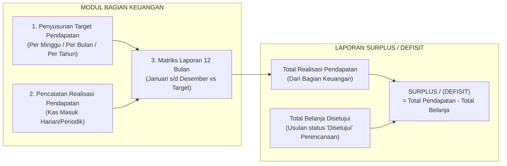

# [ISSUE / PLANNING] Restrukturisasi Alur Pengajuan Belanja (Unit-Perencanaan), Pembersihan Total Komponen Warisan (Database, Kode, UI), Manajemen Target Pendapatan Fleksibel (Mingguan/Bulanan/Tahunan), dan Rekapitulasi Matriks Realisasi 12 Bulan E-BLUD RSJ Tampan

**Tipe**: Core Business Workflow Refactoring / Feature Expansion / Technical Debt Purge  
**Prioritas**: P0 - Sangat Tinggi (*Critical Feedback Stakeholder*)  
**Status**: Ready for Implementation  
**Label**: `workflow-refactoring`, `requisitions`, `code-cleanup`, `revenue-target`, `monthly-matrix`, `surplus-deficit`, `perencanaan`, `keuangan`  
**Target Pelaksana**: Junior Programmer & AI Model  
*(Dokumen ini merupakan spesifikasi teknis dan panduan implementasi komprehensif hasil revisi presentasi sistem dengan stakeholder E-BLUD RS Jiwa Tampan, mencakup penambahan fitur baru sekaligus penghapusan tuntas semua artefak dan kode yang tidak lagi relevan).*

---

## 1. Latar Belakang & Analisis Hasil Evaluasi Presentasi

Berdasarkan hasil presentasi sistem aplikasi **E-BLUD RS Jiwa Tampan Provinsi Riau** bersama para stakeholder, ditemukan ketidaksesuaian mendasar antara alur kerja sistem sebelumnya dengan regulasi operasional riil rumah sakit:

### 1.1 Masalah 1: Miskonsepsi Alur Pengajuan Belanja Unit Kerja
* **Alur Sistem Lama**: Unit mengajukan &rarr; Bagian Perencanaan memverifikasi &rarr; Berkas diteruskan ke Bagian Keuangan &rarr; Bagian Keuangan memverifikasi & mencairkan (SP2D / Kuitansi).
* **Fakta Operasional Sebenarnya**: 
  * Pengajuan belanja rutin oleh Unit/Instalasi/Ruangan titik akhirnya adalah **validasi dan persetujuan final oleh Bagian Perencanaan**.
  * Pengajuan belanja unit **TIDAK SAMPAI KE BAGIAN KEUANGAN** sebagai berkas verifikasi individual.
  * Ketika usulan belanja telah disetujui (*di-ACC*) oleh Bagian Perencanaan, usulan tersebut secara otomatis memotong pagu anggaran rekening RBA belanja dan langsung diakui sebagai belanja sah BLUD (serta memicu proses RBA Pergeseran apabila pagu tidak mencukupi atau terjadi pergeseran pos anggaran).

### 1.2 Masalah 2: Penegasan dan Pemisahan Peran (*Separation of Duties*)
1. **Bagian Perencanaan**:
   * Menetapkan dan mengelola **Target Pagu Belanja (RBA Belanja Murni)**.
   * Menelaah, memvalidasi, dan memberikan **Persetujuan Final (ACC)** terhadap usulan belanja unit kerja.
   * Mengelola penyesuaian anggaran belanja melalui **RBA Pergeseran**.
2. **Bagian Keuangan**:
   * **Tidak lagi memverifikasi atau mencairkan berkas pengajuan belanja unit**.
   * Bertanggung jawab penuh menyusun **Target Pendapatan BLUD**, yang dapat ditentukan secara fleksibel dalam format **per minggu, per bulan, atau per tahun**.
   * Bertanggung jawab mencatat **Realisasi Pendapatan Harian/Periodik (Kas Masuk)**.
   * Menampilkan **Matriks Rekapitulasi Realisasi Pendapatan 12 Bulan (Januari - Desember)** secara hierarkis per kode rekening dan sub-pos layanan.
   * Menyusun **Laporan Surplus / Defisit (Laporan Operasional E-BLUD)** dengan formula:
     $$\text{Surplus / (Defisit)} = \text{Total Realisasi Pendapatan} - \text{Total Belanja (Usulan yang Telah Disetujui Perencanaan)}$$

### 1.3 Masalah 3: Bahaya *Dead Code* & Sisa Skema Warisan (*Pelajaran dari Kasus Unknown Column*)
Membiarkan sisa-sisa kolom database, route, controller, atau elemen UI dari alur lama yang tidak lagi dipakai (*dead code/legacy artifacts*) terbukti menimbulkan bug fatal di runtime (seperti kasus error `Unknown column 'original_amount'` pada controller karena ketidaksinkronan nama kolom database dan pemanggilan query). Oleh karena itu, dalam perbaikan ini:
**SEMUA hal yang tidak penting/tidak lagi digunakan di alur lama HARUS DIHAPUS SECARA TOTAL, mulai dari level database, backend code, hingga antarmuka pengguna (UI). Jangan ada yang disisakan untuk sekadar "backward compatibility" yang semu.**

---

## 2. Arsitektur Alur Bisnis Baru (Sebelum vs Sesudah)

### 2.1 Diagram Perbandingan Alur Pengajuan Belanja

```mermaid
flowchart TD
    subgraph OLD["ALUR LAMA (SALAH - AKAN DIHAPUS TOTAL)"]
        direction TB
        O1["Unit Kerja Buat Usulan"] --> O2["Verifikasi Bag. Perencanaan"]
        O2 -->|Diteruskan| O3["Verifikasi Bag. Keuangan (DIHAPUS)"]
        O3 -->|Pencairan SP2D (DIHAPUS)| O4["Selesai Cair (DIHAPUS)"]
    end

    subgraph NEW["ALUR BARU HASIL REVISI (BENAR & RINGKAS)"]
        direction TB
        N1["Unit Kerja (Ruangan / Instalasi)<br/>Mengajukan Usulan Belanja"] --> N2["Bagian Perencanaan<br/>Telaah & Validasi Pagu RBA"]
        N2 -->|Disetujui / ACC Final| N3["Status: Disetujui (Final)<br/>Memotong Pagu Rekening RBA"]
        N2 -->|Ditolak / Catatan Revisi| N4["Status: Ditolak<br/>Kembali ke Unit Kerja"]
        N3 -.->|Jika Pagu Kurang / Geser Pos| N5["Proses RBA Pergeseran"]
        
        N3 ==>|Otomatis Diakui Sebagai| N6["Realisasi Belanja Disetujui<br/>(Sumber Data Laporan Surplus/Defisit)"]
    end
```

### 2.2 Diagram Interaksi Modul Keuangan (Pendapatan & Surplus-Defisit)



---

## 3. Rencana Pembersihan Total Komponen Warisan (*Comprehensive Deletion & Cleanup Plan*)

Untuk menjamin kebersihan codebase dan stabilitas aplikasi, implementor wajib menghapus komponen berikut secara tuntas:

### 3.1 Pembersihan Basis Data (*Database Cleanup*)
Tabel `requisitions` dibersihkan dari seluruh kolom dan status yang terkait dengan verifikasi/pencairan keuangan:
1. **Drop Kolom dari Tabel `requisitions`**:
   - `approved_by_keuangan_id` *(drop foreign key `requisitions_approved_by_keuangan_id_foreign` terlebih dahulu)*.
   - `approved_keuangan_at`.
   - `notes_keuangan`.
   - `sp2d_number`.
   - `receipt_number`.
2. **Pembersihan Enum Status `requisitions.status`**:
   - Status lama yang dihapus: `Diproses_Keuangan` dan `Disetujui_Selesai`.
   - Sebelum mengubah definisi enum, jalankan update data:
     ```sql
     UPDATE requisitions 
     SET status = 'Disetujui' 
     WHERE status IN ('Diproses_Keuangan', 'Disetujui_Selesai');
     ```
   - Definisi baru enum:
     ```sql
     ALTER TABLE requisitions MODIFY COLUMN status ENUM(
         'Draft',
         'Pending_Perencanaan',
         'Disetujui',
         'Ditolak'
     ) NOT NULL DEFAULT 'Pending_Perencanaan';
     ```

### 3.2 Pembersihan Kode Backend (*Backend Code Cleanup*)
1. **HAPUS FILE CONTROLLER**:
   - **Hapus Permanen**: `app/Http/Controllers/Keuangan/RequisitionController.php`.  
     *(Bagian Keuangan tidak lagi memiliki urusan memvalidasi atau memproses berkas usulan per unit).*
2. **Hapus Rute Terkait di `routes/web.php`**:
   - Hapus semua deklarasi route yang mengarah ke `Keuangan\RequisitionController`:
     - `GET /keuangan/requisitions`
     - `GET /keuangan/requisitions/{requisition}`
     - `POST /keuangan/requisitions/{requisition}/verify`
     - `POST /keuangan/requisitions/{requisition}/disburse`
     - `GET /keuangan/requisitions/{requisition}/print-sp2d`
3. **Pembersihan Model `app/Models/Requisition.php`**:
   - Hapus relasi `approvedByKeuangan()`.
   - Hapus properti dari `$fillable`: `'approved_by_keuangan_id'`, `'approved_keuangan_at'`, `'notes_keuangan'`, `'sp2d_number'`, `'receipt_number'`.
   - Hapus properti dari `$casts`: `'approved_keuangan_at'`.
   - Hapus konstanta status: `STATUS_DIPROSES_KEUANGAN = 'Diproses_Keuangan'` dan `STATUS_DISETUJUI_SELESAI = 'Disetujui_Selesai'`.
   - Tambahkan/gunakan konstanta: `STATUS_DISETUJUI = 'Disetujui'`.
   - Perbarui helper `isApproved()`: cukup memeriksa `status === self::STATUS_DISETUJUI`.
4. **Refactoring Controller Perencanaan (`app/Http/Controllers/Perencanaan/RequisitionController.php`)**:
   - Pada method `approve()`: ubah status berkas langsung menjadi **`Disetujui`** (tidak lagi diarahkan ke Keuangan).
   - Langsung mutasikan sisa pagu rekening belanja:
     ```php
     $rbaAccount = RbaAccount::find($requisition->rba_account_id);
     if ($rbaAccount) {
         $rbaAccount->remaining_budget = max(0, (float) $rbaAccount->remaining_budget - (float) $requisition->total_approved);
         $rbaAccount->spent_budget = (float) $rbaAccount->spent_budget + (float) $requisition->total_approved;
         $rbaAccount->save();
     }
     ```
5. **Pembersihan Monitoring & Super Admin**:
   - Pada `app/Http/Controllers/SuperAdmin/MonitoringController.php` & `DashboardController.php`:
     - Hapus relasi `approvedByKeuangan` dari query `with(...)`.
     - Hapus filter dan penghitungan status `Diproses_Keuangan` & `Disetujui_Selesai`, gantikan dengan `Disetujui`.

### 3.3 Pembersihan Antarmuka Pengguna (*Frontend UI Cleanup*)
1. **HAPUS DIREKTORI HALAMAN**:
   - **Hapus Direktori**: `resources/js/Pages/Keuangan/Requisitions/` beserta seluruh isinya:
     - `Index.jsx`
     - `Show.jsx`
     - `Partials/FinanceDisbursementModal.jsx`
2. **Pembersihan Layout Keuangan (`resources/js/Layouts/KeuanganLayout.jsx`)**:
   - Hapus menu "Validasi Requisition" / "Pencairan SP2D" dari sidebar navigasi.
   - Gantikan dengan menu baru: **"Target Pendapatan BLUD"** dan submenu laporan **"Matriks Pendapatan 12 Bulan"**.
3. **Pembersihan Tampilan Unit Kerja (`resources/js/Pages/Divisi/Requisitions/`)**:
   - Pada `Show.jsx`:
     - Hapus step ke-3 (Verifikasi Keuangan / SP2D) pada timeline/stepper pengajuan.
     - Stepper hanya memiliki 2 tahapan: **1. Pengajuan Usulan** &rarr; **2. Telaah & Persetujuan Perencanaan**.
     - Hapus bagian kartu rincian SP2D, Nomor Kuitansi, dan Catatan Keuangan.
   - Pada `Index.jsx`:
     - Hapus filter tab / badge `Diproses Keuangan` dan `Selesai Cair`.
     - Badge yang aktif: `Draft (Abu-abu)`, `Diajukan / Pending Perencanaan (Kuning)`, `Disetujui (Hijau Emerald)`, `Ditolak (Merah)`.
4. **Pembersihan Tampilan Perencanaan (`resources/js/Pages/Perencanaan/Requisitions/Show.jsx`)**:
   - Hapus teks "Berkas akan diteruskan ke Bagian Keuangan untuk pencairan".
   - Ubah tombol modal menjadi **"Setujui & Sahkan Pengajuan (ACC Final)"** dengan penjelasan: *"Usulan yang disetujui sah memotong pagu RBA dan diakui sebagai realisasi belanja."*
5. **Pembersihan Monitoring Super Admin (`resources/js/Pages/SuperAdmin/Monitoring/Requisitions.jsx`)**:
   - Hapus kolom `No. SP2D / Kuitansi` dari tabel monitoring.
   - Hapus filter status lama dan sesuaikan dengan status baru `Disetujui`.

---

## 4. Spesifikasi Modul Baru: Target Pendapatan Fleksibel (`revenue_targets`)

Modul ini adalah fitur utama baru bagi **Bagian Keuangan** untuk merencanakan target pendapatan rumah sakit dengan fleksibilitas alokasi (Tahunan, Bulanan, atau Mingguan).

### 4.1 Skema Tabel `revenue_targets`

```sql
CREATE TABLE revenue_targets (
    id BIGINT UNSIGNED AUTO_INCREMENT PRIMARY KEY,
    fiscal_year INT NOT NULL COMMENT 'Tahun Anggaran, contoh: 2027',
    account_code VARCHAR(50) NOT NULL COMMENT 'Kode Rekening e.g. 4.1.4.16 atau kode pos pendapatan',
    account_name VARCHAR(255) NOT NULL COMMENT 'Nama Akun / Uraian Layanan Pendapatan',
    category VARCHAR(100) NOT NULL DEFAULT 'Jasa Layanan' COMMENT 'Jasa Layanan, Hasil Kerjasama, APBD, APBN, Lain-lain PAD Sah',
    period_type ENUM('yearly', 'monthly', 'weekly') NOT NULL DEFAULT 'monthly' COMMENT 'Tipe alokasi pengisian target',
    target_yearly DECIMAL(18, 2) NOT NULL DEFAULT 0.00 COMMENT 'Total nominal target tahunan',
    
    -- Target per Bulan (Januari s/d Desember)
    target_jan DECIMAL(18, 2) NOT NULL DEFAULT 0.00,
    target_feb DECIMAL(18, 2) NOT NULL DEFAULT 0.00,
    target_mar DECIMAL(18, 2) NOT NULL DEFAULT 0.00,
    target_apr DECIMAL(18, 2) NOT NULL DEFAULT 0.00,
    target_may DECIMAL(18, 2) NOT NULL DEFAULT 0.00,
    target_jun DECIMAL(18, 2) NOT NULL DEFAULT 0.00,
    target_jul DECIMAL(18, 2) NOT NULL DEFAULT 0.00,
    target_aug DECIMAL(18, 2) NOT NULL DEFAULT 0.00,
    target_sep DECIMAL(18, 2) NOT NULL DEFAULT 0.00,
    target_oct DECIMAL(18, 2) NOT NULL DEFAULT 0.00,
    target_nov DECIMAL(18, 2) NOT NULL DEFAULT 0.00,
    target_dec DECIMAL(18, 2) NOT NULL DEFAULT 0.00,
    
    -- Breakdown target mingguan (opsional dalam format JSON untuk fleksibilitas)
    weekly_breakdown JSON NULL COMMENT 'Format JSON: {"jan": [w1, w2, w3, w4], "feb": [...]}',
    
    notes TEXT NULL,
    created_by BIGINT UNSIGNED NULL,
    updated_by BIGINT UNSIGNED NULL,
    created_at TIMESTAMP NULL DEFAULT CURRENT_TIMESTAMP,
    updated_at TIMESTAMP NULL ON UPDATE CURRENT_TIMESTAMP,
    
    CONSTRAINT fk_revenue_targets_creator FOREIGN KEY (created_by) REFERENCES users(id) ON DELETE SET NULL,
    CONSTRAINT fk_revenue_targets_updater FOREIGN KEY (updated_by) REFERENCES users(id) ON DELETE SET NULL,
    INDEX idx_revenue_targets_year_code (fiscal_year, account_code)
) ENGINE=InnoDB DEFAULT CHARSET=utf8mb4 COLLATE=utf8mb4_unicode_ci;
```

### 4.2 Struktur Rekening & Pemetaan Data Pendapatan BLUD RSJ Tampan
Hierarki pos pendapatan mengacu pada dokumen baku RS Jiwa Tampan:

| Kode Rekening | Level | Uraian Rekening Pendapatan | Kategori Induk | Target Contoh (TA 2027) |
| :--- | :---: | :--- | :--- | :--- |
| **4** | 1 | **PENDAPATAN** | Root Akun 4 | Rp 32.469.887.914,00 |
| **4.1** | 2 | **PENDAPATAN ASLI DAERAH** | PAD | Rp 32.469.887.914,00 |
| **4.1.4** | 3 | **Lain-lain Pendapatan Asli Daerah yang Sah** | PAD Sah | Rp 32.469.887.914,00 |
| **4.1.4.16** | 4 | **Pendapatan BLUD** | Pendapatan BLUD | Rp 32.469.887.914,00 |
| - | 5 | **Pendapatan Jasa Layanan** | Header Jasa Layanan | Rp 31.393.537.914,00 |
| - | 6 | Pendapatan Pelayanan Gawat Darurat | Jasa Layanan | Rp 135.195.000,00 |
| - | 6 | Pendapatan Pelayanan Intensif/UPIP | Jasa Layanan | Rp 257.500.000,00 |
| - | 6 | Pendapatan Pelayanan Rawat Jalan | Jasa Layanan | Rp 7.521.895.000,00 |
| - | 6 | Pendapatan Pelayanan Rawat Inap | Jasa Layanan | Rp 18.608.697.914,00 |
| - | 6 | Pendapatan Pelayanan Rawat Inap-Napza | Jasa Layanan | Rp 750.000.000,00 |
| - | 6 | Pendapatan Pelayanan Rehabilitasi Psikososial | Jasa Layanan | Rp 0,00 |
| - | 6 | Pendapatan Pelayanan Psikologi | Jasa Layanan | Rp 625.000.000,00 |
| - | 6 | Pendapatan Pelayanan Konseling Keperawatan Jiwa | Jasa Layanan | Rp 13.000.000,00 |
| - | 6 | Pendapatan Pelayanan Forensik Psikiatri | Jasa Layanan | Rp 21.000.000,00 |
| - | 6 | Pendapatan Pelayanan Laboratorium | Jasa Layanan | Rp 500.000.000,00 |
| - | 6 | Pendapatan Pelayanan Radiologi | Jasa Layanan | Rp 28.750.000,00 |
| - | 6 | Pendapatan Pelayanan Gizi | Jasa Layanan | Rp 8.000.000,00 |
| - | 6 | Pendapatan Pelayanan Farmasi | Jasa Layanan | Rp 2.565.500.000,00 |
| - | 6 | Pendapatan Pelayanan Rekam Medik | Jasa Layanan | Rp 359.000.000,00 |
| - | 6 | Pendapatan Pelayanan Ambulance/Kereta Jenazah | Jasa Layanan | Rp 0,00 |
| - | 5 | **Hibah** | Hibah | Rp 0,00 |
| - | 5 | **Hasil Kerjasama** | Header Kerja Sama | Rp 376.350.000,00 |
| - | 6 | Hasil Kerjasama Diklat | Hasil Kerja Sama | Rp 150.000.000,00 |
| - | 6 | Hasil Kerjasama Penggunaan Fasilitas RSJ Tampan | Hasil Kerja Sama | Rp 226.350.000,00 |
| - | 5 | **Pendapatan dari APBD** (Operasional & Investasi) | APBD | Rp 0,00 |
| - | 5 | **Pendapatan dari APBN** | APBN | Rp 0,00 |
| - | 5 | **Lain-lain Pendapatan BLUD yang Sah** | Header Lain-lain | Rp 700.000.000,00 |
| - | 6 | Jasa Giro | Lain-lain BLUD Sah | Rp 400.000.000,00 |
| - | 6 | Pendapatan Bunga | Lain-lain BLUD Sah | Rp 0,00 |
| - | 6 | Pendapatan Lain-Lain BLUD | Lain-lain BLUD Sah | Rp 300.000.000,00 |

### 4.3 Fitur Antarmuka Pengaturan Target (`Keuangan/RevenueTargets/Index.jsx`)
1. **Pilihan Mode Alokasi**:
   - **Mode Tahunan**: User memasukkan target 1 tahun penuh, sistem menyediakan tombol otomatis: *"Bagi Rata ke 12 Bulan"* (`target_yearly / 12`).
   - **Mode Bulanan**: User mengisi nominal spesifik per bulan (Januari s/d Desember), sistem otomatis menghitung `target_yearly = SUM(target_jan .. target_dec)`.
   - **Mode Mingguan**: Membuka popup rincian 4-5 minggu per bulan untuk proyeksi arus kas jangka pendek.
2. **Kalkulasi Otomatis Baris Induk**: Ketika nilai sub-pos diubah, nilai pos induk (seperti `Pendapatan Jasa Layanan`, `Hasil Kerjasama`, hingga total akumulatif `Pendapatan BLUD`) otomatis terakumulasi.

---

## 5. Spesifikasi Matriks Rekapitulasi Realisasi Pendapatan 12 Bulan (Januari - Desember)

### 5.1 Format Tabel Matriks Bulanan (`Keuangan/Reports/RevenueMonthlyMatrix.jsx`)
Format tampilan mengadopsi 100% tata letak laporan evaluasi kinerja pendapatan RS Jiwa Tampan:

```text
+---------------+------------------------+-------------------+---------------------+-----+----------------------+--------------------+--------------------+---------------+
| Kode Rekening | Uraian                 | Jumlah Anggaran   | REALISASI (Jan-Des) | ... | TOTAL REALISASI      | SISA ANGGARAN      | % Realisasi        |
| (1)           | (2)                    | (3) [Target]      | (4 s.d. 15)         | ... | (16 = SUM Jan..Des)  | (17 = Col 3 - 16)  | (18 = 16/3 * 100%) |
+---------------+------------------------+-------------------+---------------------+-----+----------------------+--------------------+--------------------+---------------+
| 4             | PENDAPATAN             | 32.469.887.914,00 | Jan: 2.193.463.410  | ... | 24.298.959.965,00    | (8.170.927.949,00) | 74,84%            |
| 4.1           | PENDAPATAN ASLI DAERAH | 32.469.887.914,00 | Jan: 2.193.463.410  | ... | 24.298.959.965,00    | (8.170.927.949,00) | 74,84%            |
| 4.1.4         | Lain-lain PAD yg Sah   | 32.469.887.914,00 | Jan: 2.193.463.410  | ... | 24.298.959.965,00    | (8.170.927.949,00) | 74,84%            |
| 4.1.4.16      | Pendapatan BLUD        | 32.469.887.914,00 | Jan: 2.193.463.410  | ... | 24.298.959.965,00    | (8.170.927.949,00) | 74,84%            |
|               | Pendapatan Jasa Layanan| 31.393.537.914,00 | Jan: 2.154.434.994  | ... | 23.856.954.615,00    | (7.536.583.299,00) | 75,99%            |
|               | Pelayanan Rawat Jalan  |  7.521.895.000,00 | Jan:   504.115.700  | ... |  3.460.744.137,00    | (4.061.150.863,00) | 46,01%            |
|               | Pelayanan Farmasi      |  2.565.500.000,00 | Jan:   114.655.237  | ... |  1.576.600.861,00    |   (988.899.139,00) | 61,45%            |
|               | Hasil Kerjasama Diklat |    150.000.000,00 | Jan:    32.450.000  | ... |    205.911.700,00    |     55.911.700,00  | 137,27%           |
|               | Jasa Giro              |    400.000.000,00 | Jan:     3.965.007  | ... |     47.680.241,00    |   (352.319.759,00) | 11,92%            |
+---------------+------------------------+-------------------+---------------------+-----+----------------------+--------------------+--------------------+---------------+
| TOTAL PENDAPATAN BLUD                  | 32.469.887.914,00 |                     | ... | 24.298.959.965,00    | (8.170.927.949,00) | 74,84%            |
+---------------+------------------------+-------------------+---------------------+-----+----------------------+--------------------+--------------------+---------------+
```

### 5.2 Logika Perhitungan Kolom
1. **Jumlah Anggaran / Target (Kolom 3)**:
   * Mengambil data `revenue_targets.target_yearly` untuk tahun fiskal aktif.
   * Baris induk level 1-4 diakumulasikan secara rekursif dari seluruh sub-pos di bawahnya.
2. **Realisasi Bulanan (Kolom 4 s/d 15: JAN - DES)**:
   * Mengagregasi nominal kas masuk dari tabel `revenues` per bulan:
     $$\text{Realisasi}(m) = \sum \text{amount} \quad \text{dimana } \text{MONTH}(date) = m \text{ dan } \text{YEAR}(date) = \text{active\_year}$$
3. **Total Realisasi (Kolom 16)**:
   $$\text{Total Realisasi} = \sum_{m=1}^{12} \text{Realisasi}(m)$$
4. **Sisa Anggaran Target (Kolom 17)**:
   $$\text{Sisa Anggaran} = \text{Jumlah Anggaran} - \text{Total Realisasi}$$
   *Aturan Tampilan*:
   * Jika nilai bernilai positif (target belum tercapai penuh), tampilkan dalam format akuntansi tanda kurung: `(Rp xxx.xxx,xx)`.
   * Jika nilai negatif atau terlampaui (surplus target), tampilkan positif tanpa kurung: `Rp xxx.xxx,xx`.
5. **Persentase Capaian (Kolom 18: % Realisasi)**:
   $$\% \text{ Realisasi} = \begin{cases} \left( \frac{\text{Total Realisasi}}{\text{Jumlah Anggaran}} \times 100\% \right), & \text{jika Jumlah Anggaran} > 0 \\ 0.00\%, & \text{jika Jumlah Anggaran} = 0 \end{cases}$$

### 5.3 Fasilitas Ekspor & Cetak
* **Ekspor Excel (.xlsx / .csv)**: Menyertakan seluruh kolom dan format angka akuntansi.
* **Cetak Resmi PDF/Print View**: Menggunakan layout lanskap (*A4/F4 Landscape*) dengan kop surat resmi Pemerintah Provinsi Riau - Rumah Sakit Jiwa Tampan, tanggal cetak dinamis, serta kolom tanda tangan Direktur dan Bendahara Penerimaan.

---

## 6. Spesifikasi Laporan Operasional Surplus / Defisit

Laporan Surplus/Defisit (`Keuangan/Reports/SurplusDeficit.jsx`) diperbarui untuk menggunakan belanja riil yang telah disetujui Bagian Perencanaan:

### 6.1 Formula Perhitungan
$$\text{Surplus / (Defisit)} = \text{Total Pendapatan Realisasi} - \text{Total Belanja Disetujui}$$

* **Total Pendapatan Realisasi**: Akumulasi seluruh penerimaan kas masuk dari tabel `revenues` pada tahun aktif.
* **Total Belanja Disetujui**:
  ```php
  $totalBelanjaDisetujui = (float) Requisition::where(function ($q) use ($activeYear) {
          $q->where('budget_year', $activeYear)->orWhere('fiscal_year', $activeYear);
      })
      ->where('status', 'Disetujui')
      ->sum('total_approved');
  ```

### 6.2 Indikator Status Finansial
* **SURPLUS**: Jika `Total Pendapatan >= Total Belanja` (Badge Hijau Emerald, nilai surplus positif).
* **DEFISIT**: Jika `Total Pendapatan < Total Belanja` (Badge Merah Rose, nilai defisit dalam kurung).

---

## 7. Inventaris Komponen: Dibuat, Diubah, dan Dihapus

### 7.1 Komponen yang DIHAPUS TOTAL (Purged)

| No | File / Objek | Layer | Alasan Penghapusan |
| :--- | :--- | :---: | :--- |
| 1 | `app/Http/Controllers/Keuangan/RequisitionController.php` | Backend Controller | **DEAD CODE**. Keuangan tidak lagi memverifikasi usulan belanja unit. |
| 2 | `routes/web.php` (rute `keuangan.requisitions.*`) | Backend Route | **DEAD ROUTE**. Menghindari endpoint tak terpakai yang memicu celah keamanan. |
| 3 | `resources/js/Pages/Keuangan/Requisitions/` *(seluruh isi folder)* | Frontend View | **DEAD VIEW**. Halaman antrean dan verifikasi keuangan dihapus tuntas. |
| 4 | `resources/js/Pages/Keuangan/Requisitions/Partials/FinanceDisbursementModal.jsx` | Frontend Component | **DEAD COMPONENT**. Modal pencairan SP2D tidak digunakan lagi. |
| 5 | Kolom `approved_by_keuangan_id`, `approved_keuangan_at`, `notes_keuangan`, `sp2d_number`, `receipt_number` | Database Schema | **DEAD SCHEMA**. Mencegah error `Unknown column` dan menjaga integritas tabel `requisitions`. |
| 6 | Nilai Enum `Diproses_Keuangan` dan `Disetujui_Selesai` pada `requisitions.status` | Database Schema | **DEAD ENUM**. Disederhanakan menjadi `Disetujui`. |

### 7.2 Komponen Baru yang DIBUAT (Created)

| No | File Path | Layer | Deskripsi & Fungsi |
| :--- | :--- | :---: | :--- |
| 1 | `database/migrations/xxxx_xx_xx_cleanup_requisitions_and_update_status_enum.php` | Database | Migration untuk drop kolom warisan keuangan dan memperbarui enum status `requisitions`. |
| 2 | `database/migrations/xxxx_xx_xx_create_revenue_targets_table.php` | Database | Migration untuk tabel baru `revenue_targets` (tahunan, 12 bulan, mingguan). |
| 3 | `database/seeders/RevenueTargetSeeder.php` | Database | Seeder target pendapatan default RSJ Tampan TA 2027 sesuai angka riil stakeholder. |
| 4 | `app/Models/RevenueTarget.php` | Eloquent Model | Model target pendapatan BLUD beserta casts, helper, dan scope tahun fiskal. |
| 5 | `app/Http/Controllers/Keuangan/RevenueTargetController.php` | Backend Controller | Controller penyusunan dan pengeditan target pendapatan per rekening. |
| 6 | `resources/js/Pages/Keuangan/RevenueTargets/Index.jsx` | Frontend View | Tampilan form pengaturan target tahunan, bulanan, dan mingguan dengan kalkulasi otomatis. |
| 7 | `resources/js/Pages/Keuangan/Reports/RevenueMonthlyMatrix.jsx` | Frontend View | Tampilan tabel matriks realisasi pendapatan 12 bulan (Jan-Des), ekspor Excel, dan cetak. |
| 8 | `resources/js/Pages/Shared/PrintRevenueMonthlyMatrix.jsx` | Frontend View | Template cetak laporan matriks 12 bulan ber-kop resmi RS Jiwa Tampan (Landscape). |
| 9 | `tests/Feature/RevenueWorkflowAndCleanupTest.php` | Automated Test | Pengujian menyeluruh alur baru, penghapusan kolom lama, target pendapatan, dan matriks 12 bulan. |

### 7.3 Komponen yang DIMODIFIKASI (Updated)

| No | File Path | Layer | Rangkuman Perubahan |
| :--- | :--- | :---: | :--- |
| 1 | `app/Models/Requisition.php` | Backend Model | Hapus relasi `approvedByKeuangan`, bersihkan `$fillable`, sesuaikan konstanta status. |
| 2 | `app/Http/Controllers/Perencanaan/RequisitionController.php` | Backend Controller | Status approval langsung `Disetujui`, mutasikan sisa pagu `rba_accounts`. |
| 3 | `app/Http/Controllers/Keuangan/ReportController.php` | Backend Controller | Tambahkan method `revenueMonthlyMatrix()`, perbarui formula `surplusDeficit()`. |
| 4 | `app/Http/Controllers/Divisi/RequisitionController.php` | Backend Controller | Bersihkan filter `Diproses_Keuangan`. |
| 5 | `app/Http/Controllers/SuperAdmin/MonitoringController.php` | Backend Controller | Hapus relasi keuangan lama, perbarui filter status. |
| 6 | `resources/js/Layouts/KeuanganLayout.jsx` | Frontend Layout | Hapus menu validasi belanja, tambahkan menu Target Pendapatan & Matriks 12 Bulan. |
| 7 | `resources/js/Pages/Divisi/Requisitions/Index.jsx` & `Show.jsx` | Frontend View | Hapus stepper step 3 dan kolom SP2D, tampilkan status final `Disetujui`. |
| 8 | `resources/js/Pages/Perencanaan/Requisitions/Show.jsx` | Frontend View | Ubah tombol menjadi "Setujui & Sahkan Pengajuan", hapus narasi penerusan ke keuangan. |
| 9 | `resources/js/Pages/Keuangan/Reports/SurplusDeficit.jsx` | Frontend View | Hitung komparasi pendapatan kas terhadap usulan disetujui Perencanaan. |
| 10| `resources/js/Pages/SuperAdmin/Monitoring/Requisitions.jsx` | Frontend View | Hapus kolom SP2D dan filter lama. |

---

## 8. Panduan Langkah demi Langkah (*Step-by-Step Implementation Guide*)

Junior Programmer atau AI Model wajib mengeksekusi tahapan ini secara berurutan:

### Tahap 1: Pembersihan Skema Basis Data & Migrasi Baru
1. Buat migration `cleanup_requisitions_and_update_status_enum`:
   - Lakukan migrasi data lama: ubah status `Diproses_Keuangan` dan `Disetujui_Selesai` menjadi `Disetujui`.
   - Drop foreign key `requisitions_approved_by_keuangan_id_foreign`.
   - Drop kolom `approved_by_keuangan_id`, `approved_keuangan_at`, `notes_keuangan`, `sp2d_number`, `receipt_number`.
   - Modifikasi enum `status` menjadi `['Draft', 'Pending_Perencanaan', 'Disetujui', 'Ditolak']`.
2. Buat migration `create_revenue_targets_table` sesuai Bagian 4.1.
3. Buat seeder `RevenueTargetSeeder.php` dengan data riil RS Jiwa Tampan (Total target Rp 32.469.887.914,00).
4. Jalankan `php artisan migrate` dan `php artisan db:seed --class=RevenueTargetSeeder`.

### Tahap 2: Pembersihan Backend & Refactor Approval Perencanaan
1. Hapus file `app/Http/Controllers/Keuangan/RequisitionController.php`.
2. Buka `routes/web.php`: hapus seluruh rute `keuangan.requisitions.*`.
3. Buka `app/Models/Requisition.php`: bersihkan relasi `approvedByKeuangan`, fillable, cast, dan perbarui konstanta status.
4. Buka `app/Http/Controllers/Perencanaan/RequisitionController.php`:
   - Saat approval di-submit, set `status = 'Disetujui'`, kurangi `remaining_budget` dan tambahkan `spent_budget` pada `rba_accounts`.
5. Buka `app/Http/Controllers/SuperAdmin/MonitoringController.php` & `DashboardController.php`: bersihkan eager load dan query status lama.

### Tahap 3: Pembersihan Antarmuka Pengguna (UI)
1. Hapus folder `resources/js/Pages/Keuangan/Requisitions/` beserta isinya.
2. Edit `resources/js/Layouts/KeuanganLayout.jsx`: buang menu validasi pengajuan unit, pasang menu target pendapatan dan matriks 12 bulan.
3. Edit `resources/js/Pages/Divisi/Requisitions/Show.jsx` & `Index.jsx`: buang step 3 stepper dan kolom SP2D, tampilkan status sah disetujui Perencanaan.
4. Edit `resources/js/Pages/Perencanaan/Requisitions/Show.jsx`: tombol ACC final mandiri.
5. Edit `resources/js/Pages/SuperAdmin/Monitoring/Requisitions.jsx`: bersihkan filter dan kolom SP2D.

### Tahap 4: Implementasi Modul Target Pendapatan Keuangan
1. Buat model `app/Models/RevenueTarget.php`.
2. Buat controller `app/Http/Controllers/Keuangan/RevenueTargetController.php` dengan rute `GET /keuangan/revenue-targets` dan `POST /keuangan/revenue-targets`.
3. Buat view `resources/js/Pages/Keuangan/RevenueTargets/Index.jsx` lengkap dengan tab alokasi (Tahunan, Bulanan, Mingguan) dan kalkulator bagi rata.

### Tahap 5: Implementasi Matriks Realisasi Pendapatan 12 Bulan (Jan - Des)
1. Pada `app/Http/Controllers/Keuangan/ReportController.php`, buat method `revenueMonthlyMatrix()`:
   - Ambil target dari `revenue_targets`.
   - Agregasi realisasi dari `revenues` per bulan (Januari s/d Desember).
   - Hitung total realisasi, sisa anggaran (dengan format kurung untuk sisa belum tercapai), dan % realisasi.
2. Buat view `resources/js/Pages/Keuangan/Reports/RevenueMonthlyMatrix.jsx`.
3. Buat template cetak `resources/js/Pages/Shared/PrintRevenueMonthlyMatrix.jsx` (Lanskap dengan kop dinamis).
4. Sediakan fitur ekspor Excel.

### Tahap 6: Rekalkulasi Laporan Surplus / Defisit
1. Pada `app/Http/Controllers/Keuangan/ReportController.php::surplusDeficit()`:
   - Hitung belanja dari seluruh usulan yang berstatus `'Disetujui'` oleh Perencanaan.
   - Hitung selisih: $\text{Pendapatan} - \text{Belanja Disetujui}$.
2. Perbarui tampilan `resources/js/Pages/Keuangan/Reports/SurplusDeficit.jsx`.

### Tahap 7: Harmonisasi & Pengujian Menyeluruh (*Testing & Verification*)
1. Tambahkan feature test di `tests/Feature/RevenueWorkflowAndCleanupTest.php`.
2. Jalankan `php artisan test` & pastikan semua test lulus 100%.
3. Jalankan `npm run build` & pastikan aset terkompilasi bersih tanpa peringatan.

---

## 9. Kriteria Penerimaan (*Acceptance Criteria*)

- [ ] **Dead Code & Dead Columns Dihapus Tuntas (0% Sisa)**:
  - File `Keuangan/RequisitionController.php` dan folder `resources/js/Pages/Keuangan/Requisitions/` sudah terhapus permanen.
  - Rute `keuangan.requisitions.*` tidak lagi terdaftar di sistem (`php artisan route:list` bersih).
  - Kolom `approved_by_keuangan_id`, `approved_keuangan_at`, `notes_keuangan`, `sp2d_number`, `receipt_number` sudah tidak ada di tabel `requisitions`.
  - Enum `status` pada tabel `requisitions` murni hanya terdiri dari: `'Draft'`, `'Pending_Perencanaan'`, `'Disetujui'`, `'Ditolak'`.
- [ ] **Alur Usulan Berhenti di Perencanaan**: Usulan belanja unit divalidasi dan disetujui final oleh Perencanaan (status langsung `Disetujui`), tidak ada lagi antrean ke Keuangan.
- [ ] **Pemotongan Pagu RBA Belanja Otomatis**: Ketika Perencanaan menyetujui usulan, `remaining_budget` rekening belanja RBA langsung berkurang dan `spent_budget` bertambah.
- [ ] **Modul Target Pendapatan Aktif & Fleksibel**: Bagian Keuangan dapat mengatur target pendapatan per rekening dengan alokasi tahunan, bulanan (12 bulan), maupun mingguan.
- [ ] **Matriks 12 Bulan Sesuai Dokumen Riil RSJ**: Tabel Matriks Realisasi Pendapatan Bulanan berhasil merender 12 kolom bulan (Januari s/d Desember), total realisasi, sisa anggaran target, dan persentase capaian (% Realisasi) persis seperti format dokumen rumah sakit.
- [ ] **Formula Surplus-Defisit Akurat**: Laporan Surplus-Defisit menghitung `Total Realisasi Kas Pendapatan` dikurangi `Total Belanja Usulan yang Telah Disetujui Perencanaan`.
- [ ] **Cetak & Ekspor Berfungsi**: Dokumen Matriks 12 Bulan dapat dicetak rapi dalam mode cetak lanskap (*A4/F4 Landscape*) dengan kop surat resmi RSJ Tampan dan diekspor ke Excel.
- [ ] **Zero Regressions**: Seluruh automated tests (`php artisan test`) lulus 100% dan aset Vite (`npm run build`) terkompilasi bersih.
