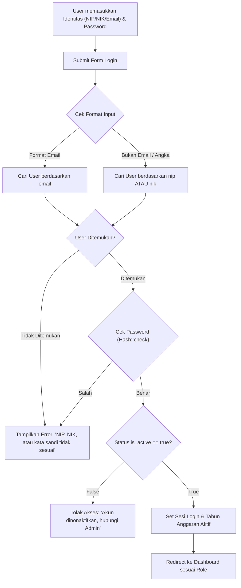

# Issue: Pembaruan Autentikasi Login Menggunakan NIP atau NIK pada Sistem E-BLUD RS Jiwa Tampan

**Tipe**: Feature / Refactor  
**Prioritas**: Tinggi (High)  
**Status**: Ready for Implementation  
**Label**: `authentication`, `auth-flow`, `database-migration`, `frontend-ui`, `backend-api`  
**Target Pelaksana**: Junior Programmer & AI Model  

---

## 1. Latar Belakang & Masalah

Berdasarkan hasil presentasi dan evaluasi sistem bersama stakeholder RS Jiwa Tampan Provinsi Riau, terdapat masukan krusial terkait alur autentikasi pengguna (*login flow*):

1. **Karakteristik Pegawai RSJ Tampan (BLUD)**:
   - **Pegawai ASN (PNS & PPPK)**: Memiliki **NIP** resmi pemerintah (18 digit angka).
   - **Pegawai Non-ASN (Tenaga Kontrak, Honorer, Tenaga BLUD Non-PNS)**: **TIDAK** memiliki NIP, namun seluruh warga negara Indonesia wajib memiliki **NIK** KTP (16 digit angka).
2. **Kondisi Sistem Saat Ini**:
   - Form login saat ini dirancang menggunakan **Email** kedinasan (dengan fallback parsial ke NIP).
   - Input login tidak ramah bagi staf operasional lapangan/ruangan yang lebih sering menghafal NIP atau NIK dibanding email kedinasan.
   - Pada tabel `users` di database, **belum terdapat kolom `nik`**, hanya ada kolom `nip` dan `email`.
   - Modul Kelola Pengguna di Admin belum menyediakan input pencatatan NIK pegawai.

3. **Permintaan Pengguna (User Requirement)**:
   - Mengubah mekanisme login agar pengguna dapat melakukan autentikasi menggunakan **NIP atau NIK** secara fleksibel dalam satu field input yang sama.
   - Sistem harus secara cerdas mendeteksi apakah nomor yang dimasukkan adalah NIP atau NIK pegawai yang terdaftar, lalu memvalidasi kata sandinya.
   - Sebagai *failsafe / backward compatibility*, akun sistem Administrator (misal: `admin@rsj.com`) tetap diperbolehkan masuk via email kedinasan agar tidak terkunci saat NIP/NIK belum terekam.

---

## 2. Tujuan & Sasaran Akhir (*Acceptance Criteria*)

- [ ] Tabel `users` memiliki kolom `nik` (varchar 20, nullable, unique, indexed).
- [ ] Pegawai dapat login menggunakan **NIP** (18 digit) dan kata sandi yang valid.
- [ ] Pegawai dapat login menggunakan **NIK** (16 digit) dan kata sandi yang valid.
- [ ] Administrator sistem tetap dapat login menggunakan email kedinasan.
- [ ] Label dan placeholder pada form login (`Login.jsx`) diperbarui menjadi `"NIP atau NIK"` dengan petunjuk format yang jelas.
- [ ] Admin dapat menginput dan memperbarui data NIK pegawai pada form tambah/edit pengguna di panel Administrator.
- [ ] Pesan validasi error login berbahasa Indonesia yang jelas, aman, dan informatif.
- [ ] Seluruh pengujian fitur autentikasi (Unit/Feature Test & E2E) lulus 100%.

---

## 3. Rencana Arsitektur & Perubahan Teknis

### 3.1 Skema Alur Autentikasi Baru (*Authentication Flow*)



---

## 4. Tahapan Implementasi Langkah demi Langkah (*Step-by-Step Guide*)

Ikuti 7 tahapan berikut secara berurutan. Jangan melompati tahapan agar tidak terjadi inkonsistensi data.

---

### TAHAP 1: Database Migration — Penambahan Kolom `nik`

#### 1.1 Buat File Migrasi Baru
Jalankan perintah Artisan di terminal:
```bash
php artisan make:migration add_nik_to_users_table --table=users
```

#### 1.2 Isi Migrasi
Buka file migrasi yang baru dibuat di `database/migrations/xxxx_xx_xx_xxxxxx_add_nik_to_users_table.php`, dan ubah method `up()` dan `down()`:

```php
<?php

use Illuminate\Database\Migrations\Migration;
use Illuminate\Database\Schema\Blueprint;
use Illuminate\Support\Facades\Schema;

return new class extends Migration
{
    /**
     * Run the migrations.
     */
    public function up(): void
    {
        Schema::table('users', function (Blueprint $table) {
            // NIK terdiri dari 16 digit angka KTP di Indonesia
            $table->string('nik', 20)->nullable()->unique()->after('nip');
            
            // Tambahkan index gabungan untuk performa query pencarian NIP & NIK
            $table->index('nip', 'users_nip_idx');
            $table->index('nik', 'users_nik_idx');
        });
    }

    /**
     * Reverse the migrations.
     */
    public function down(): void
    {
        Schema::table('users', function (Blueprint $table) {
            $table->dropIndex('users_nik_idx');
            $table->dropIndex('users_nip_idx');
            $table->dropColumn('nik');
        });
    }
};
```

#### 1.3 Jalankan Migrasi
```bash
php artisan migrate
```

---

### TAHAP 2: Pembaruan Model `App\Models\User.php`

#### 2.1 Tambahkan Properti & Mass Assignment
Buka file `app/Models/User.php`:
1. Tambahkan `@property string|null $nik` pada blok PHPDoc class.
2. Pastikan kolom `nik` diizinkan dalam `$fillable` atau `$guarded`. Karena model ini menggunakan `protected $guarded = [];`, kolom `nik` sudah otomatis terlindungi dan dapat diisi.

```php
/**
 * @property int $id
 * @property string $name
 * @property string|null $nip
 * @property string|null $nik
 * @property string $email
...
```

---

### TAHAP 3: Pembaruan Logika Autentikasi `App\Http\Requests\Auth\LoginRequest.php`

File ini adalah jantung dari proses validasi dan percobaan login.

#### 3.1 Update Pesan Validasi
Buka `app/Http/Requests\Auth\LoginRequest.php`:
Pada method `messages()`, perbarui pesan error agar relevan dengan NIP / NIK:

```php
public function messages(): array
{
    return [
        'email.required' => 'NIP, NIK, atau Email kedinasan wajib diisi.',
        'password.required' => 'Kata sandi wajib diisi.',
        'captcha.required' => 'Kode captcha wajib diisi sebelum klik masuk.',
    ];
}
```

#### 3.2 Update Method `authenticate()`
Perbarui logika pencarian pengguna agar mendukung **NIP**, **NIK**, dan fallback **Email**:

```php
public function authenticate(): void
{
    $this->ensureIsNotRateLimited();

    // 1. Validasi Captcha (Tetap pertahankan logika captcha yang sudah ada)
    if (! app()->environment('testing') || $this->filled('captcha')) {
        $expected = session('login_captcha');
        $inputCaptcha = $this->input('captcha');

        $isTestBypass = app()->environment(['local', 'testing']) && strtoupper(trim((string) $inputCaptcha)) === 'TEST1';

        if (! $isTestBypass && (! $expected || strtoupper(trim((string) $inputCaptcha)) !== strtoupper($expected))) {
            session(['login_captcha' => AuthenticatedSessionController::generateCaptchaCode()]);

            throw ValidationException::withMessages([
                'captcha' => 'Kode captcha tidak sesuai. Silakan masukkan kode yang tertera.',
            ]);
        }
    }

    // 2. Normalisasi Input Identitas (Bersihkan spasi di awal/akhir dan tanda strip)
    $loginInput = trim((string) $this->input('email'));
    $sanitizedId = str_replace([' ', '-', '.'], '', $loginInput);
    $isEmail = filter_var($loginInput, FILTER_VALIDATE_EMAIL);

    // 3. Pencarian User Secara Dinamis (NIP / NIK / Email)
    $user = null;

    if ($isEmail) {
        $user = \App\Models\User::where('email', $loginInput)->first();
    } else {
        // Cari berdasarkan NIP atau NIK
        $user = \App\Models\User::where('nip', $sanitizedId)
            ->orWhere('nip', $loginInput)
            ->orWhere('nik', $sanitizedId)
            ->orWhere('nik', $loginInput)
            ->first();

        // Fallback jika input berupa username email tanpa domain (cth: "admin" -> "admin@rsj.com")
        if (! $user && ! is_numeric($sanitizedId)) {
            $user = \App\Models\User::where('email', $loginInput)
                ->orWhere('email', 'like', $loginInput . '@%')
                ->first();
        }
    }

    // 4. Verifikasi Keberadaan User dan Password
    if (! $user || ! \Illuminate\Support\Facades\Hash::check($this->input('password'), $user->password)) {
        RateLimiter::hit($this->throttleKey());

        session(['login_captcha' => AuthenticatedSessionController::generateCaptchaCode()]);

        throw ValidationException::withMessages([
            'email' => 'NIP, NIK, atau kata sandi yang Anda masukkan salah.',
        ]);
    }

    // 5. Cek Status Keaktifan Akun
    if (! $user->is_active) {
        throw ValidationException::withMessages([
            'email' => 'Akun Anda sedang dinonaktifkan. Silakan hubungi Administrator SIM-RS / Bagian Kepegawaian.',
        ]);
    }

    // 6. Login User ke Session
    Auth::login($user, $this->boolean('remember'));

    session()->forget('login_captcha');

    $selectedYear = (int) ($this->input('fiscal_year') ?: (FiscalYear::getDefaultYear() ?? date('Y')));
    session(['active_year' => $selectedYear]);

    RateLimiter::clear($this->throttleKey());
}
```

---

### TAHAP 4: Pembaruan Antarmuka Pengguna Login (`resources/js/Pages/Auth/Login.jsx`)

Buka `resources/js/Pages/Auth/Login.jsx`:

#### 4.1 Ubah Label dan Placeholder Field Identitas
Cari blok `Input Email / NIP` (sekitar baris 126–143) dan sesuaikan:

**Sebelum:**
```jsx
{/* Input Email / NIP */}
<div>
    <label htmlFor="email" className="mb-1.5 block text-xs font-semibold text-slate-700">
        NIP
    </label>
    <input
        id="email"
        type="text"
        name="email"
        value={data.email}
        autoComplete="username"
        autoFocus
        onChange={(e) => setData('email', e.target.value)}
        placeholder="masukkan NIP atau NIK"
        className="block w-full rounded-xl border border-slate-200 bg-[#edf4fc] px-3.5 py-2.5 text-sm text-slate-900 placeholder:text-slate-400 focus:bg-white focus:border-emerald-600 focus:ring-1 focus:ring-emerald-600 transition"
    />
    <InputError message={errors.email} className="mt-1.5" />
</div>
```

**Sesudah:**
```jsx
{/* Input NIP / NIK / Email */}
<div>
    <label htmlFor="email" className="mb-1.5 block text-xs font-semibold text-slate-700">
        NIP atau NIK Pegawai
    </label>
    <div className="relative">
        <input
            id="email"
            type="text"
            name="email"
            value={data.email}
            autoComplete="username"
            autoFocus
            onChange={(e) => setData('email', e.target.value)}
            placeholder="Masukkan NIP (18 digit) atau NIK (16 digit)"
            className="block w-full rounded-xl border border-slate-200 bg-[#edf4fc] pl-3.5 pr-10 py-2.5 text-sm font-medium text-slate-900 placeholder:text-slate-400 focus:bg-white focus:border-emerald-600 focus:ring-1 focus:ring-emerald-600 transition"
        />
        <div className="pointer-events-none absolute inset-y-0 right-0 flex items-center pr-3.5 text-slate-400">
            <svg className="h-4 w-4" fill="none" viewBox="0 0 24 24" strokeWidth={1.8} stroke="currentColor">
                <path strokeLinecap="round" strokeLinejoin="round" d="M15.75 6a3.75 3.75 0 11-7.5 0 3.75 3.75 0 017.5 0zM4.501 20.118a7.5 7.5 0 0114.998 0A17.933 17.933 0 0112 21.75c-2.676 0-5.216-.584-7.499-1.632z" />
            </svg>
        </div>
    </div>
    <p className="mt-1 text-[11px] text-slate-500">
        PNS/PPPK gunakan 18 digit NIP. Pegawai Non-PNS gunakan 16 digit NIK KTP.
    </p>
    <InputError message={errors.email} className="mt-1.5" />
</div>
```

---

### TAHAP 5: Pembaruan Manajemen Pengguna di Panel Admin

Agar Admin dapat mendaftarkan NIK pegawai baru dan memperbarui data pegawai yang sudah ada:

#### 5.1 Controller: `app/Http/Controllers/Admin/UserController.php`
1. Pada method `store()`:
   Tambahkan aturan validasi `nik`:
   ```php
   'nip' => ['nullable', 'string', 'max:30', 'unique:users,nip'],
   'nik' => ['nullable', 'string', 'max:20', 'unique:users,nik'],
   ```
   Tambahkan pesan error:
   ```php
   'nik.unique' => 'NIK ini sudah terdaftar untuk pegawai lain.',
   ```
   Simpan kolom `nik`:
   ```php
   'nik' => $validated['nik'] ?? null,
   ```

2. Pada method `update()`:
   Tambahkan aturan validasi unik saat update:
   ```php
   'nip' => ['nullable', 'string', 'max:30', Rule::unique('users')->ignore($user->id)],
   'nik' => ['nullable', 'string', 'max:20', Rule::unique('users')->ignore($user->id)],
   ```
   Simpan kolom `nik`:
   ```php
   'nik' => $validated['nik'] ?? null,
   ```

3. Pada method `index()` dan `DashboardController.php`:
   Pastikan kolom `nik` ikut di-select pada query list users.

#### 5.2 Modal Form: `resources/js/Pages/Admin/Users/Partials/UserFormModal.jsx`
1. Tambahkan state `nik` pada `useForm`:
   ```javascript
   const { data, setData, post, put, processing, errors, reset } = useForm({
       name: '',
       nip: '',
       nik: '',
       email: '',
       // ...
   });
   ```
2. Isi `nik` saat modal dibuka dalam mode edit (`useEffect`):
   ```javascript
   nik: user.nik || '',
   ```
3. Ubah grid NIP menjadi 2 kolom (NIP & NIK), lalu No HP diletakkan berdampingan atau di bawahnya:
   ```jsx
   {/* Grid 2 Kolom NIP & NIK */}
   <div className="grid grid-cols-2 gap-3">
       <div>
           <div className="flex items-center justify-between mb-1">
               <label className="block text-xs font-medium text-slate-700">NIP Pegawai (PNS/PPPK)</label>
               <span className="text-[10px] text-slate-400">Opsional</span>
           </div>
           <input
               type="text"
               value={data.nip}
               maxLength={30}
               onChange={(e) => setData('nip', e.target.value.replace(/\s+/g, ''))}
               placeholder="18 digit NIP"
               className="block w-full h-10 rounded-xl border border-slate-300 bg-white px-3 py-2 text-xs font-mono text-slate-900 focus:border-teal-500 focus:ring-1 focus:ring-teal-500 transition"
           />
           <InputError message={errors.nip} className="mt-1" />
       </div>

       <div>
           <div className="flex items-center justify-between mb-1">
               <label className="block text-xs font-medium text-slate-700">NIK KTP (Non-PNS/Wajib)</label>
               <span className="text-[10px] text-slate-400">Opsional</span>
           </div>
           <input
               type="text"
               value={data.nik}
               maxLength={16}
               onChange={(e) => setData('nik', e.target.value.replace(/\D/g, ''))}
               placeholder="16 digit NIK KTP"
               className="block w-full h-10 rounded-xl border border-slate-300 bg-white px-3 py-2 text-xs font-mono text-slate-900 focus:border-teal-500 focus:ring-1 focus:ring-teal-500 transition"
           />
           <InputError message={errors.nik} className="mt-1" />
       </div>
   </div>
   ```

#### 5.3 Tabel Daftar Pengguna: `resources/js/Pages/Admin/Users/Index.jsx`
Tampilkan NIK di samping atau di bawah NIP pada badge tabel:
```jsx
<td className="whitespace-nowrap px-5 py-4">
    <div className="flex flex-col gap-1">
        {u.nip && (
            <span className="inline-flex items-center rounded-full bg-blue-100 px-2.5 py-0.5 text-[11px] font-mono font-bold text-blue-900 border border-blue-200">
                NIP. {u.nip}
            </span>
        )}
        {u.nik && (
            <span className="inline-flex items-center rounded-full bg-slate-100 px-2.5 py-0.5 text-[11px] font-mono font-semibold text-slate-700 border border-slate-200">
                NIK. {u.nik}
            </span>
        )}
        {!u.nip && !u.nik && (
            <span className="text-xs text-slate-400 italic">Belum diisi</span>
        )}
    </div>
</td>
```

---

### TAHAP 6: Pembaruan Seeder & Factory

Buka `database/seeders/UserSeeder.php` dan `database/factories/UserFactory.php`:
1. Tambahkan NIK realistis (16 digit, misal berawalan `1471...` untuk kode Riau/Pekanbaru) pada user demo utama (Admin, Perencana, Bendahara, Pegawai IGD, Pegawai Farmasi).
2. Tambahkan satu user khusus Non-PNS yang **hanya memiliki NIK** (tanpa NIP) untuk membuktikan bahwa user Non-PNS bisa login hanya bermodalkan NIK.

Contoh data seeder:
```php
[
    'name' => 'Ns. Siti Rahma, S.Kep (Tenaga BLUD Non-PNS)',
    'nip' => null, // Tidak punya NIP
    'nik' => '1471015508950001', // 16 digit NIK Riau
    'email' => 'siti.blud@rsj.com',
    'password' => $passwordHash,
    'role' => 'divisi',
    'position' => 'Perawat Pelaksana Rawat Inap',
    'phone' => '081277889901',
    'is_active' => true,
    'division_id' => $rawat?->id,
    'unit_id' => $unitRanapPria?->id,
]
```

---

### TAHAP 7: Pengujian & Verifikasi (*Testing & QA*)

#### 7.1 Automated Feature Test (`tests/Feature/Auth/AuthenticationTest.php`)
Tambahkan skenario pengujian baru pada file pengujian:
1. `test_users_can_authenticate_using_nip()`
2. `test_users_can_authenticate_using_nik()`
3. `test_users_without_nip_can_authenticate_using_nik()`
4. `test_users_can_not_authenticate_with_unregistered_nip_or_nik()`
5. `test_inactive_users_can_not_authenticate_via_nip_or_nik()`

Contoh implementasi test:
```php
public function test_users_can_authenticate_using_nip(): void
{
    $user = User::factory()->create([
        'nip' => '199501012020011001',
        'password' => bcrypt('password123'),
    ]);

    $response = $this->post('/login', [
        'email' => '199501012020011001',
        'password' => 'password123',
    ]);

    $this->assertAuthenticatedAs($user);
}

public function test_users_can_authenticate_using_nik(): void
{
    $user = User::factory()->create([
        'nip' => null,
        'nik' => '1471015508950002',
        'password' => bcrypt('password123'),
    ]);

    $response = $this->post('/login', [
        'email' => '1471015508950002',
        'password' => 'password123',
    ]);

    $this->assertAuthenticatedAs($user);
}
```

Jalankan pengujian menggunakan:
```bash
php artisan test --filter=AuthenticationTest
```

#### 7.2 Uji Coba Manual di Browser
1. Buka halaman `/login`.
2. Pastikan label field bertuliskan `"NIP atau NIK Pegawai"`.
3. Masukkan NIP salah satu akun PNS beserta password -> Pastikan berhasil login.
4. Logout, lalu masukkan NIK salah satu akun Non-PNS beserta password -> Pastikan berhasil login.
5. Masukkan NIP/NIK yang salah -> Pastikan muncul pesan error `"NIP, NIK, atau kata sandi yang Anda masukkan salah."`.
6. Buka panel Admin (`/admin/users`) -> Klik Tambah Pengguna -> Pastikan field NIP dan NIK tersedia dan dapat disimpan dengan validasi unik.

---

## 5. Ringkasan Berkas yang Dibuat & Dimodifikasi (*File Checklist*)

| No | Lokasi Berkas | Status | Deskripsi Pekerjaan |
|---|---|---|---|
| 1 | `database/migrations/xxxx_xx_xx_add_nik_to_users_table.php` | **Baru** | Menambahkan kolom `nik` (varchar 20, unique, index) |
| 2 | `app/Models/User.php` | **Modifikasi** | Menambahkan properti PHPDoc `$nik` |
| 3 | `app/Http/Requests/Auth/LoginRequest.php` | **Modifikasi** | Menambahkan logika pencarian multi-kredensial (NIP/NIK/Email) |
| 4 | `resources/js/Pages/Auth/Login.jsx` | **Modifikasi** | Memperbarui label, placeholder, dan helper text form login |
| 5 | `app/Http/Controllers/Admin/UserController.php` | **Modifikasi** | Validasi dan penyimpanan field `nik` pada `store()` dan `update()` |
| 6 | `resources/js/Pages/Admin/Users/Partials/UserFormModal.jsx` | **Modifikasi** | Input field NIK KTP (16 digit) pada modal tambah/edit user |
| 7 | `resources/js/Pages/Admin/Users/Index.jsx` | **Modifikasi** | Menampilkan badge NIK pada kolom tabel pengguna |
| 8 | `database/seeders/UserSeeder.php` | **Modifikasi** | Menambahkan sampel data NIK untuk pegawai PNS dan Non-PNS |
| 9 | `tests/Feature/Auth/AuthenticationTest.php` | **Modifikasi** | Menambahkan unit test login NIP dan NIK |

---

## 6. Catatan Keamanan & Kepatuhan BLUD

1. **Format NIK**: NIK KTP di Indonesia terdiri dari 16 digit angka tetap (`\d{16}`). Pada frontend, cegah karakter non-numerik saat input NIK.
2. **Format NIP**: NIP ASN di Indonesia terdiri dari 18 digit angka (`YYYYMMDD YYYYMM X XXX`). Sistem harus menerima input NIP baik yang menggunakan spasi maupun tanpa spasi (lakukan *sanitization* `str_replace(' ', '', $input)`).
3. **Pencegahan Enumerasi Akun**: Pesan kesalahan login tidak boleh membedakan antara "NIP tidak ditemukan" dan "Kata sandi salah". Gunakan pesan gabungan netral: *"NIP, NIK, atau kata sandi yang Anda masukkan salah."* untuk menjaga keamanan sistem sesuai standar OWASP.
